# MOTORENT — Software Design Specification (SDS v1.1)

**Project Name:** Motorbike Rental Management System (MOTORENT)  
**Document Type:** Software Design Specification (FPT University Standard)  
**Version:** 1.1 — October 2026 (50 Core Use Cases, 50 Sequence Diagrams)  

---

## Record of Changes

| Date | A*M, D | In charge | Change Description |
|---|---|---|---|
| 26/09/2026 | A | HoangTQB | Initial release of Software Design Specification (v1.0) |
| 18/10/2026 | M | HoangTQB | Updated SDS to v1.1 covering 18 MongoDB collections and 50 core Use Cases (UC-01..UC-50) |
| 29/10/2026 | M | HoangTQB | Completed full Class Diagrams, Class Specifications, 50 Sequence Diagrams (1 per UC), and Mongoose Database Queries |

---

## I. Overview

### 1. Code Packages

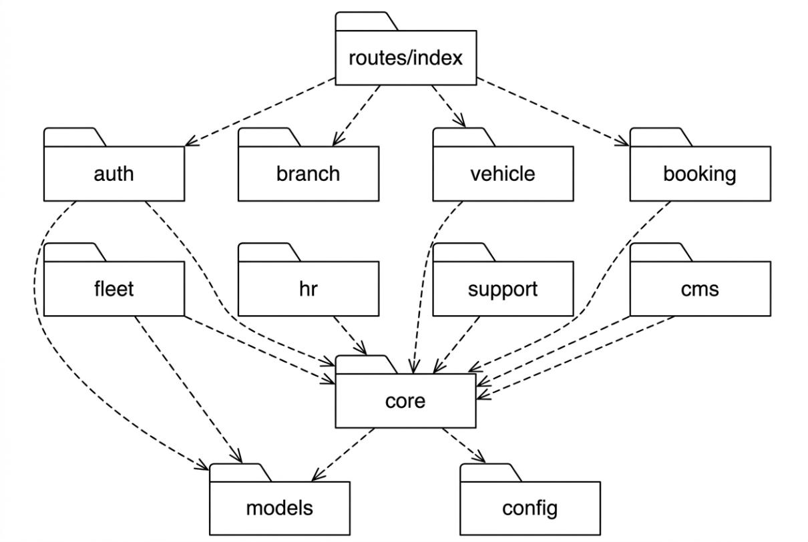

| No | Package | Description |
|---|---|---|
| 01 | `routes/index` | Central route aggregator. Imports all module routers and mounts them under /api prefix with appropriate middleware chains. |
| 02 | `auth` | Authentication & eKYC module: register, login (email + Google OAuth), email verification, forgot/reset password, upload identity documents (CCCD, driving license). |
| 03 | `branch` | Branch management module: CRUD operations, GPS-based nearest branch search, operating hours configuration, manager assignment. |
| 04 | `vehicle` | Vehicle & category management module: fleet CRUD, multi-filter search, pricing (daily/hourly/seasonal), availability checking. |
| 05 | `booking` | Central booking workflow module: create order, VNPay deposit (30%), counter payment (70%), Check-in/Check-out, cancel, refund, extend rental period. |
| 06 | `fleet` | Fleet operations module: inter-branch vehicle transfers (VehicleTransfer), maintenance logging (MaintenanceLog), ODO-based service alerts. |
| 07 | `hr` | Human resources module: staff shift scheduling (StaffSchedule), clock-in/clock-out attendance tracking, shift assignment by branch manager. |
| 08 | `support` | Customer support module: 1-to-1 feedback/reviews (Feedback), complaints with resolution tracking (Complaint), SMS/email booking reminders (BookingReminder). |
| 09 | `cms` | Content management module: banner slider CRUD, static page editor (FAQ, Terms, Privacy), Socket.IO live chat (Conversation + Message). |
| 10 | `core` | Cross-cutting middleware layer: authMiddleware (JWT), rbacMiddleware (4-role RBAC), auditMiddleware (action logging), uploadMiddleware (Multer), errorHandler (centralized error response). |
| 11 | `models` | 18 Mongoose schema definitions with validation rules, virtual fields, and pre-save hooks. Each model maps to one MongoDB collection. |
| 12 | `config` | Environment configuration: MongoDB connection (database), VNPay payment gateway (vnpay), Nodemailer email transport (mailer), JWT secrets. |

#### Package & Class Naming Conventions

| Element | Convention | Example |
|---|---|---|
| Model file | `PascalCase.ts` | `Booking.ts, VehicleTransfer.ts` |
| Controller file | `camelCase + Controller.ts` | `bookingController.ts, branchController.ts` |
| Service file | `camelCase + Service.ts` | `bookingService.ts, vnpayService.ts` |
| Route file | `camelCase + Routes.ts` | `bookingRoutes.ts, vehicleRoutes.ts` |
| Middleware file | `camelCase + Middleware.ts` | `authMiddleware.ts, rbacMiddleware.ts` |
| Collection name | `lowercase plural (auto by Mongoose)` | `bookings, vehicletransfers` |
| API endpoint | `kebab-case with /api prefix` | `/api/bookings, /api/vehicle-transfers` |
| Environment var | `SCREAMING_SNAKE_CASE` | `MONGODB_URI, JWT_SECRET, VNP_HASHSECRET` |

### 2. Database Design

#### a. Database Schema

##### Group 1: Users & Branches (User, Branch)
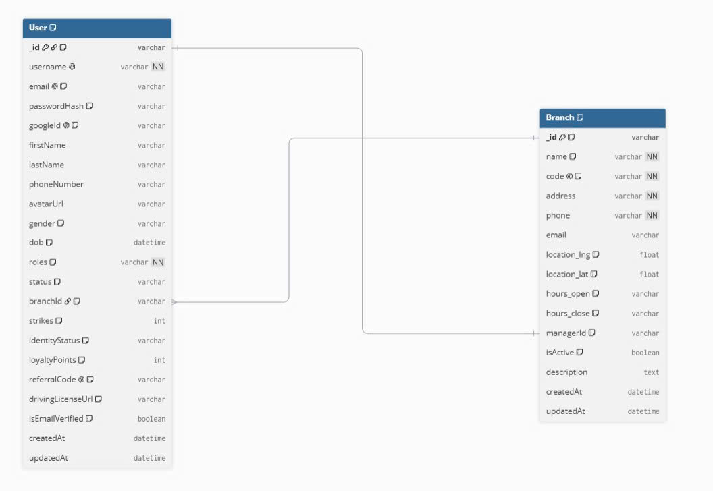

##### Group 2: Fleet & Categories (Vehicle, Category)
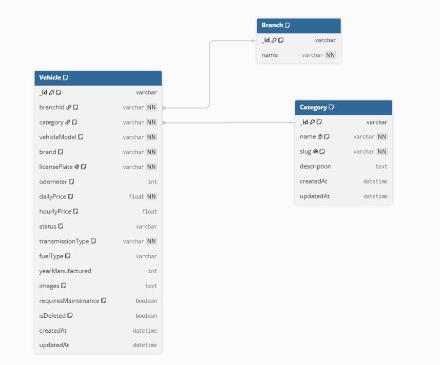

##### Group 3: Booking & Payment (Booking, Discount, BookingReminder)
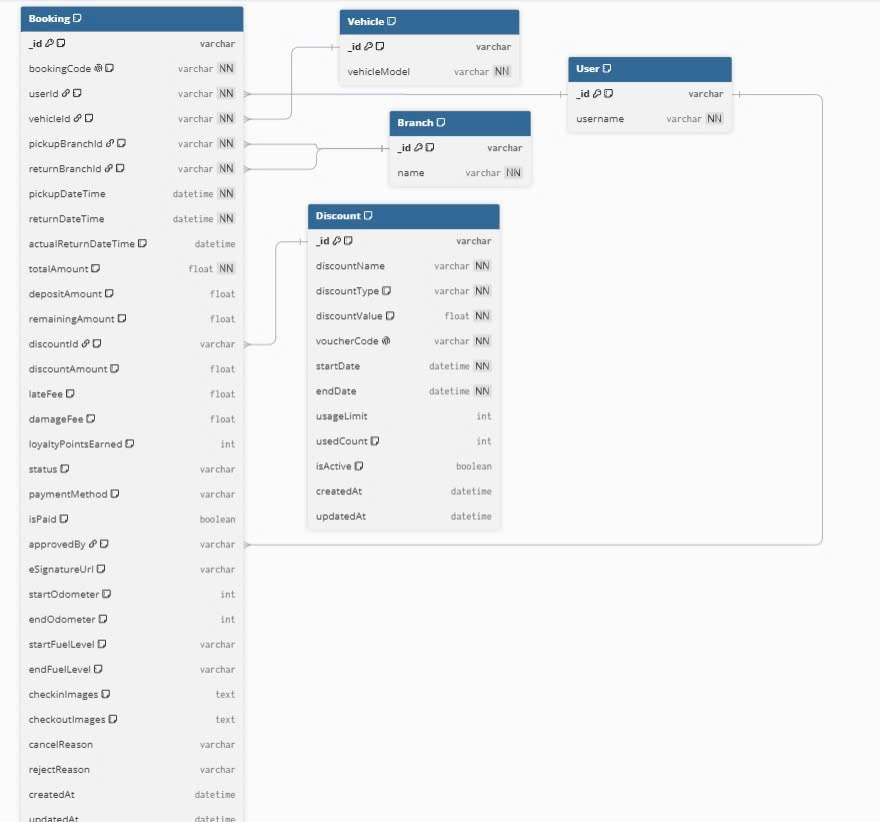

##### Group 4: Relocation & Maintenance (VehicleTransfer, MaintenanceLog)
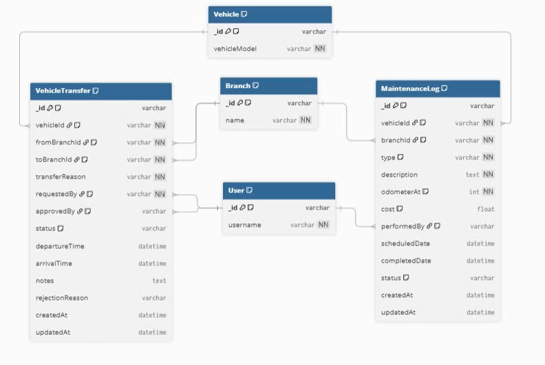

##### Group 5: Staffing & Shifts (StaffSchedule)
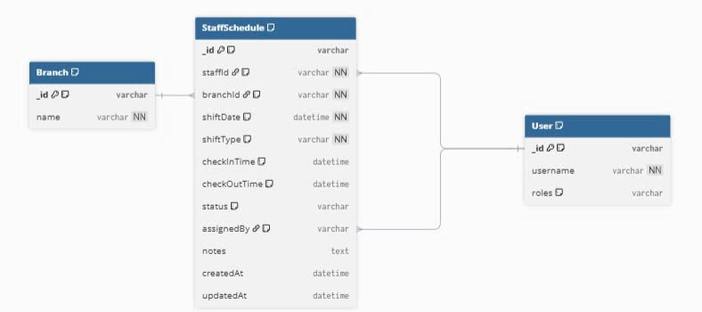

##### Group 6: Reviews, Complaints & Notifications (Feedback, Complaint, Notification)
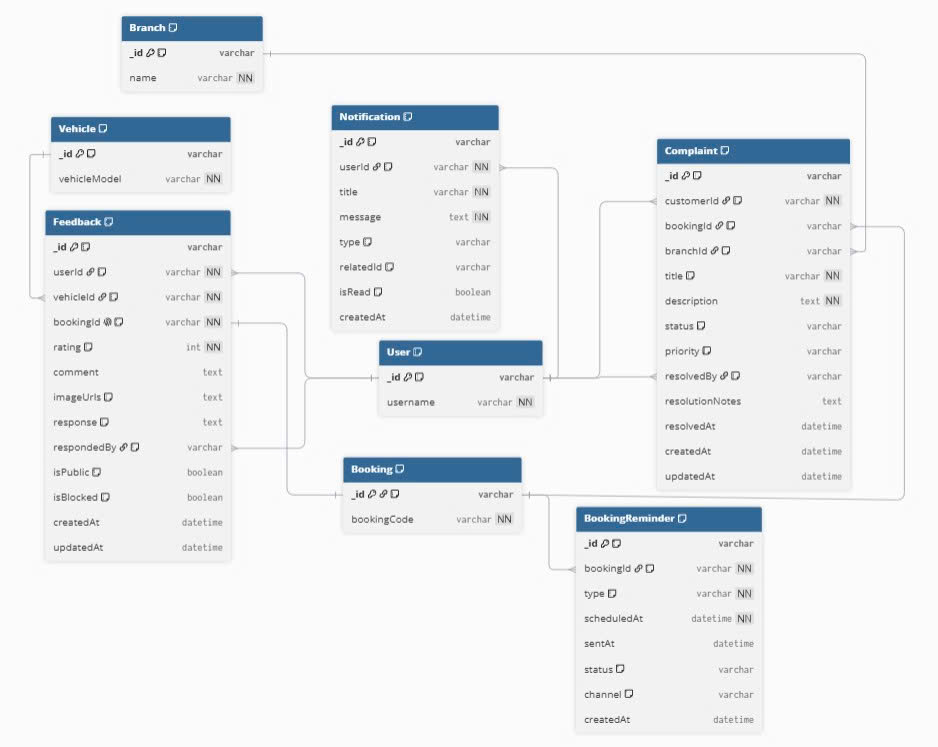

##### Group 7: CMS & Live Chat (Banner, StaticPage, Conversation, Message)
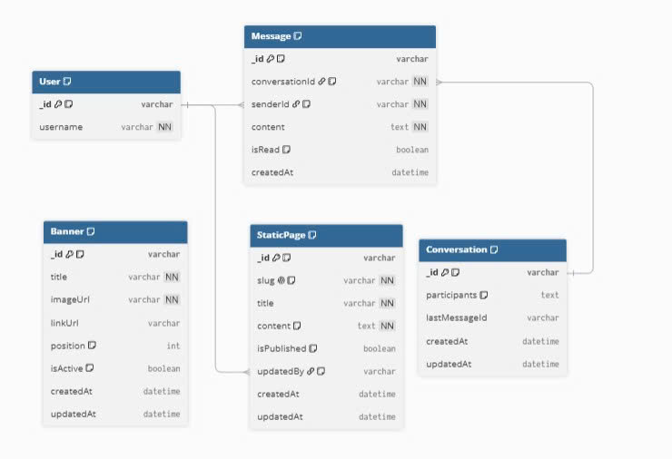

##### Group 8: Security Audit Trail (AuditLog)
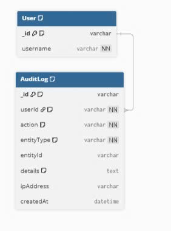

#### b. Table Description (18 Core Collections)

| No | Table | Description |
|---|---|---|
| 01 | **Branch** | Branch offices across the chain. PK: _id. FK: managerId -> User (1:1). Stores name, unique code, address, phone, email, GPS latitude/longitude, openingHours, and isActive. |
| 02 | **User** | System users across 4 RBAC roles (SystemAdmin, BranchManager, Staff, Customer). PK: _id. FK: branchId -> Branch. Stores credentials (passwordHash), profile fields, eKYC documents (CCCD/GPLX), identityStatus, loyaltyPoints, and lockout counters. |
| 03 | **Category** | Vehicle type classifications (Scooter, Manual, Semi-Auto, Electric). PK: _id. Stores name, slug, description, iconSvg, and isActive. |
| 04 | **Vehicle** | Fleet motorbikes. PK: _id. FK: branchId -> Branch, category -> Category. Stores brand, vehicleModel, unique licensePlate (BR-13), dailyPrice, hourlyPrice, odometer, maintenanceODOThreshold, 4-angle images, status (Available/Rented/Maintenance), and isDeleted. |
| 05 | **Booking** | Central rental orders. PK: _id. FK: userId -> User, vehicleId -> Vehicle, pickupBranchId -> Branch, returnBranchId -> Branch, discountId -> Discount, approvedBy -> User. Stores bookingCode (MV-XXXXXX), dates, totalAmount, depositAmount (30%), remainingAmount (70%), 4-angle checkinImages/checkoutImages, ODO/fuel readings, lateFee, damageFee, and status state machine. |
| 06 | **VehicleTransfer** | Inter-branch motorbike relocation requests (BR-16). PK: _id. FK: vehicleId -> Vehicle, fromBranchId -> Branch, toBranchId -> Branch, requestedBy -> User, approvedBy -> User. Stores reason, transferDate, and status. |
| 07 | **MaintenanceLog** | Vehicle maintenance and repair tickets (BR-15). PK: _id. FK: vehicleId -> Vehicle, branchId -> Branch, performedBy -> User. Stores description, cost, odometerAtService, serviceDate, and status. |
| 08 | **Complaint** | Customer service complaints (includes ComplaintResponse & ComplaintStatusLog). PK: _id. FK: customerId -> User, bookingId -> Booking, branchId -> Branch, resolvedBy -> User. |
| 09 | **AuditLog** | Immutable security and CRUD audit trail (BR-FR06). PK: _id. FK: userId -> User. Stores action, entity, entityId, details (JSON diff), ipAddress, and timestamp. |
| 10 | **StaffSchedule** | Staff work shift schedules and attendance logs. PK: _id. FK: staffId -> User, branchId -> Branch, assignedBy -> User. Stores date, shiftType, checkInTime, checkOutTime, and attendanceStatus. |
| 11 | **Discount** | Promotional discount codes and loyalty vouchers. PK: _id. Stores code, discountPercent, discountAmount, maxDiscountAmount, minOrderValue, startDate, endDate, usageLimit, usedCount, and isActive. |
| 12 | **Feedback** | Verified customer reviews (1:1 with completed Booking). PK: _id. FK: userId -> User, vehicleId -> Vehicle, bookingId -> Booking (unique), respondedBy -> User. Stores 1-5 rating, comment, and photos. |
| 13 | **Notification** | In-app user notifications. PK: _id. FK: userId -> User. Stores title, body, type (SYSTEM/BOOKING/REMINDER/PROMO/MAINTENANCE/TRANSFER), isRead, and data. |
| 14 | **BookingReminder** | Scheduled SMS/Email pickup & return reminders (24h and 2h prior). PK: _id. FK: bookingId -> Booking. Stores reminderType, scheduledAt, sentAt, and status. |
| 15 | **Banner** | CMS homepage hero promotional banners. PK: _id. Stores title, subtitle, imageUrl, linkUrl, displayOrder, and isActive. |
| 16 | **StaticPage** | CMS static informational & policy pages (FAQ, Terms, Privacy). PK: _id. FK: updatedBy -> User. Stores title, unique slug, sanitized HTML content, type, and isPublished. |
| 17 | **Conversation** | Real-time Socket.IO support chat sessions. PK: _id. FK: customerId -> User, branchId -> Branch, assignedStaffId -> User. Stores lastMessage, lastMessageAt, and status. |
| 18 | **Message** | Individual real-time chat messages. PK: _id. FK: conversationId -> Conversation, senderId -> User. Stores content, attachments, isRead, and createdAt. |

---

## II. Code Designs (9 Features — 50 Use Cases)

### 1. Browse & Search Feature (UC-01 .. UC-04)

Provides unauthenticated and authenticated users with public access to active branch locations (with interactive GPS coordinates and live available vehicle counts), multi-criteria motorbike catalog search and filtering, detailed motorbike specification and customer review inspection, and static rental policies (30% online deposit, 70% counter settlement, BR-06 cancellation rules).

#### a. Class Diagram

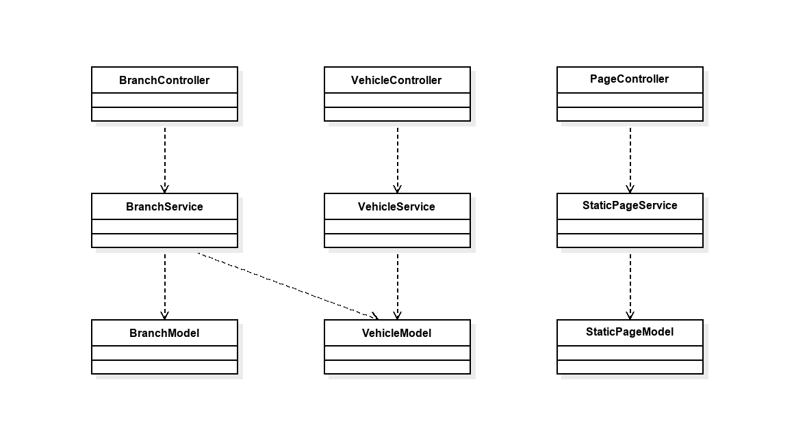

#### b. Class Specifications

##### BranchController Class
Express HTTP controller handling public and GPS-based branch discovery endpoints under /api/branches.

| No | Method | Description |
|---|---|---|
| 01 | `getAllBranches(req, res, next)` | Inputs: HTTP Request (query: isActive, search). Outputs: HTTP 200 JSON { success, data: BranchDTO[] }. Processing: Delegates to BranchService.listActiveBranches() to fetch active branches with aggregated available vehicle counts. |
| 02 | `getBranchById(req, res, next)` | Inputs: req.params.id (ObjectId). Outputs: HTTP 200 JSON { success, data: BranchDTO } or 404 AppError. Processing: Validates ObjectId and retrieves branch details and manager info via BranchService. |
| 03 | `getNearestBranches(req, res, next)` | Inputs: req.query.lat, req.query.lng, req.query.radiusKm. Outputs: HTTP 200 JSON sorted by distanceKm ASC. Processing: Parses coordinates and calls BranchService.findNearestByGps(). |

##### VehicleController Class
Express HTTP controller serving motorbike catalog search, filtering, sorting, and detailed specification views under /api/vehicles.

| No | Method | Description |
|---|---|---|
| 01 | `getAllVehicles(req, res, next)` | Inputs: req.query (keyword, branchId, category, minPrice, maxPrice, transmissionType, fuelType, status, sort, page, limit). Outputs: HTTP 200 JSON with paginated vehicle list. Processing: Invokes VehicleService.searchCatalog(). |
| 02 | `getVehicleById(req, res, next)` | Inputs: req.params.id (ObjectId). Outputs: HTTP 200 JSON { success, data: VehicleDetailDTO }. Processing: Calls VehicleService.getVehicleDetailWithReviews() to return specs, 4-angle images, pricing, and verified customer reviews. |
| 03 | `checkAvailability(req, res, next)` | Inputs: req.params.id, req.query.pickupDateTime, req.query.returnDateTime. Outputs: HTTP 200 JSON { available: boolean }. Processing: Checks overlapping bookings via VehicleService.verifyDateRangeAvailability() (BR-02). |

##### PageController Class
Express HTTP controller serving CMS static pages (Terms of Service, Rental Policy, Privacy Policy, FAQ) under /api/pages.

| No | Method | Description |
|---|---|---|
| 01 | `getPublicPageBySlug(req, res, next)` | Inputs: req.params.slug (string). Outputs: HTTP 200 JSON { success, data: StaticPageDTO } or 404. Processing: Normalizes slug and queries StaticPageService.getPublishedBySlug() omitting internal audit fields. |

##### BranchService Class
Business logic service encapsulating branch directory queries, Haversine GPS distance calculation, and live fleet availability counts.

| No | Method | Description |
|---|---|---|
| 01 | `listActiveBranches(filters)` | Inputs: BranchFilterDTO. Outputs: Promise<BranchWithCountDTO[]>. Processing: Queries Branch.find({ isActive: true }) and joins Vehicle availability aggregation. |
| 02 | `findNearestByGps(lat, lng, radiusKm)` | Inputs: latitude (number), longitude (number), radiusKm (number). Outputs: Promise<NearestBranchDTO[]>. Processing: Computes spherical Haversine distance in kilometers from user GPS to each active branch and filters within radiusKm. |

##### VehicleService Class
Business logic service managing motorbike catalog queries, specification lookup, and review rating aggregation.

| No | Method | Description |
|---|---|---|
| 01 | `searchCatalog(query)` | Inputs: VehicleSearchQueryDTO. Outputs: Promise<PaginatedVehicleResult>. Processing: Constructs dynamic Mongoose filter on isDeleted=false, branchId, category, price range, and executes paginated query. |
| 02 | `getVehicleDetailWithReviews(vehicleId)` | Inputs: vehicleId (string). Outputs: Promise<VehicleDetailDTO>. Processing: Fetches Vehicle populated with branchId and category, then queries Feedback collection for customer reviews and star distribution. |

##### StaticPageService Class
Service managing retrieval and HTML sanitization of static policy and informational pages.

| No | Method | Description |
|---|---|---|
| 01 | `getPublishedBySlug(slug)` | Inputs: slug (string). Outputs: Promise<IStaticPage>. Processing: Queries StaticPage.findOne({ slug, isPublished: true }).select('-updatedBy -__v'). |

#### c. Sequence Diagram(s) — 1 Sequence Diagram per Use Case

##### UC-01: Locate Branch Offices on Map
Guest or Customer explores active branch offices with address, hotline, operating hours, live available vehicle count, and interactive GPS map markers.

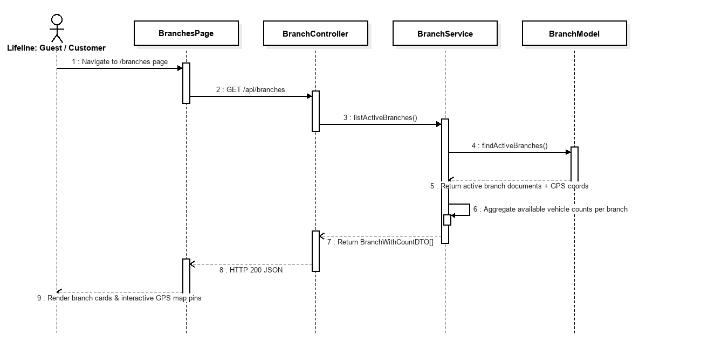

##### UC-02: Search & Filter Motorbikes
Guest or Customer searches the motorbike fleet catalog by keyword, filters by branch, category (Scooter/Manual/Semi-Auto/Electric), price range, brand, or availability, and sorts by price or rating.

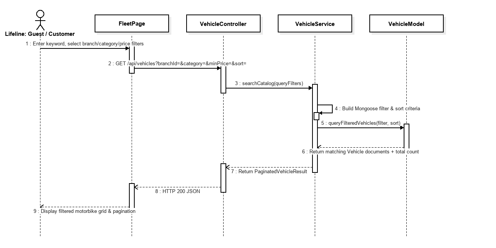

##### UC-03: Inspect Vehicle Specs & Reviews
Guest or Customer examines detailed motorbike specifications, 4-angle photo gallery, daily/hourly pricing, availability status, and verified customer reviews/ratings.

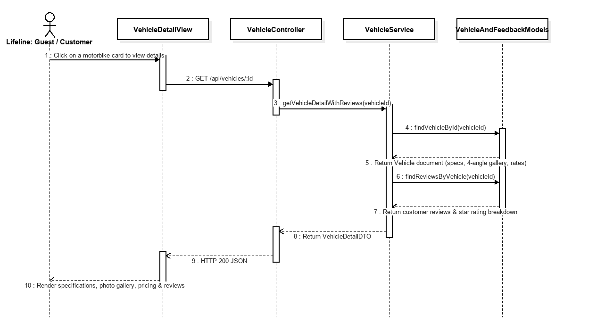

##### UC-04: Consult Rental Terms & Policies
Guest or Customer reads the rental terms, deposit rules (30% online via VNPay / 70% at counter), cancellation policy (BR-06), and insurance coverage.

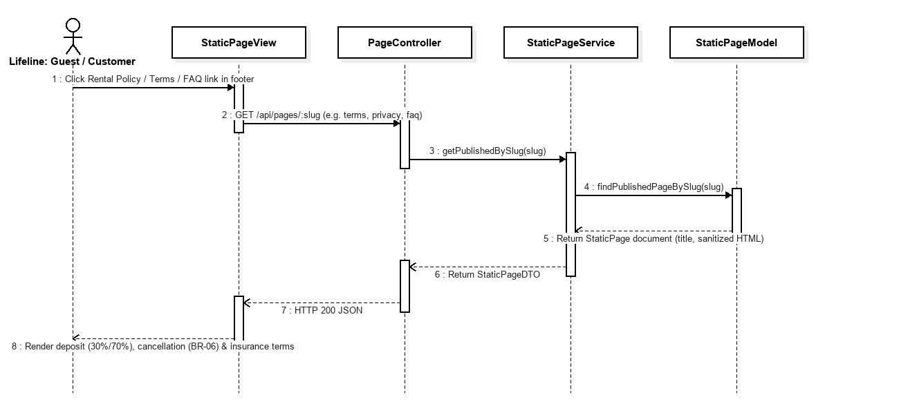

#### d. Database Queries

##### UC-01 — Locate Branch Offices on Map
```typescript
// 1. Retrieve all active branches with assigned manager info
const branches = await Branch.find({ isActive: true })
  .populate('managerId', 'firstName lastName phoneNumber email')
  .sort({ createdAt: 1 })
  .lean();

// 2. Aggregate available vehicle counts grouped by branchId
const counts = await Vehicle.aggregate([
  { $match: { isDeleted: false, status: 'Available' } },
  { $group: { _id: '$branchId', availableCount: { $sum: 1 } } }
]);
```

##### UC-02 — Search & Filter Motorbikes
```typescript
// 1. Build dynamic catalog search query and fetch paginated vehicles
const filter = {
  isDeleted: false,
  ...(branchId ? { branchId: new mongoose.Types.ObjectId(branchId) } : {}),
  ...(category ? { category: new mongoose.Types.ObjectId(category) } : {}),
  ...(status ? { status } : {}),
  ...(minPrice || maxPrice ? { dailyPrice: { ...(minPrice ? { $gte: Number(minPrice) } : {}), ...(maxPrice ? { $lte: Number(maxPrice) } : {}) } } : {}),
  ...(keyword ? { $or: [{ vehicleModel: new RegExp(keyword, 'i') }, { brand: new RegExp(keyword, 'i') }] } : {})
};
const [items, total] = await Promise.all([
  Vehicle.find(filter).populate('branchId', 'name code address').populate('category', 'name slug').sort(sortSpec).skip(skip).limit(limit).lean(),
  Vehicle.countDocuments(filter)
]);
```

##### UC-03 — Inspect Vehicle Specs & Reviews
```typescript
// 1. Fetch vehicle details populated with branch and category
const vehicle = await Vehicle.findOne({ _id: vehicleId, isDeleted: false })
  .populate('branchId', 'name code address phone openingHours latitude longitude')
  .populate('category', 'name slug description')
  .lean();

// 2. Fetch verified customer reviews for this motorbike
const reviews = await Feedback.find({ vehicleId })
  .populate('userId', 'firstName lastName username avatarUrl')
  .sort({ createdAt: -1 })
  .limit(20)
  .lean();
```

##### UC-04 — Consult Rental Terms & Policies
```typescript
// 1. Fetch published static page by slug (terms, privacy, faq)
const page = await StaticPage.findOne({
  slug: slug.trim().toLowerCase(),
  isPublished: true
}).select('-updatedBy -__v').lean();
```

---

### 2. Authentication Feature (UC-05 .. UC-08)

Handles user identity registration with bcrypt password hashing (BR-FR01) and email verification token dispatch (BR-FR04), multi-strategy authentication (email/password + Google OAuth 2.0) with 6-attempt account lockout protection (BR-FR02) and 24-hour JWT issuance (BR-FR03), single-use password reset tokens (BR-FR08), and audited session logout (BR-FR06).

#### a. Class Diagram

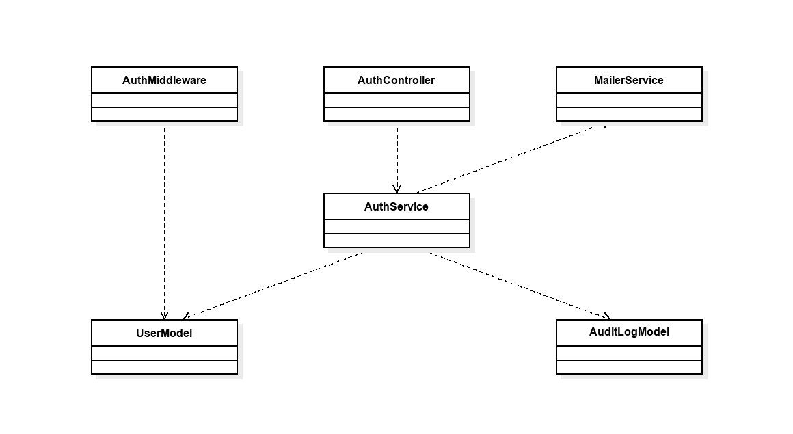

#### b. Class Specifications

##### AuthMiddleware Class
Core JWT verification middleware in server/src/core/authMiddleware.ts protecting authenticated routes.

| No | Method | Description |
|---|---|---|
| 01 | `authenticateJWT(req, res, next)` | Inputs: Authorization Bearer header. Outputs: Attaches req.user or throws 401 AppError. Processing: Verifies JWT token using env.JWT_SECRET (BR-FR03), checks User status in DB, and populates req.user. |
| 02 | `optionalAuthenticateJWT(req, res, next)` | Inputs: Optional Authorization header. Outputs: Attaches req.user if valid, otherwise continues as Guest. Processing: Non-blocking JWT verification for hybrid public/authenticated endpoints. |

##### AuthController Class
Express HTTP controller handling registration, email verification, login, Google OAuth, password recovery, and logout under /api/auth.

| No | Method | Description |
|---|---|---|
| 01 | `register(req, res, next)` | Inputs: req.body (username, email, password, firstName, lastName, phoneNumber). Outputs: HTTP 201 JSON. Processing: Validates payload and calls AuthService.registerUser(). |
| 02 | `login(req, res, next)` | Inputs: req.body (email, password). Outputs: HTTP 200 JSON { token, user }. Processing: Calls AuthService.authenticateCredentials() and returns signed 24h JWT. |
| 03 | `googleLogin(req, res, next)` | Inputs: req.body.credential (Google ID Token). Outputs: HTTP 200 JSON { token, user }. Processing: Verifies Google OAuth 2.0 token via google-auth-library and issues JWT. |
| 04 | `forgotPassword(req, res, next)` | Inputs: req.body.email. Outputs: HTTP 200 JSON. Processing: Generates single-use reset token and sends email via MailerService. |
| 05 | `resetPassword(req, res, next)` | Inputs: req.body (token, newPassword). Outputs: HTTP 200 JSON. Processing: Validates reset token expiry, updates bcrypt hash, and invalidates token (BR-FR08). |
| 06 | `logout(req, res, next)` | Inputs: AuthenticatedRequest. Outputs: HTTP 200 JSON. Processing: Records LOGOUT action in AuditLog and clears client session. |

##### AuthService Class
Core authentication domain service implementing bcrypt hashing, account lockout counters, token generation, and audit logging.

| No | Method | Description |
|---|---|---|
| 01 | `registerUser(dto)` | Inputs: RegisterDTO. Outputs: Promise<IUser>. Processing: Checks email/username uniqueness, hashes password with bcrypt (10 salt rounds, BR-FR01), creates User with roles='Customer' and identityStatus='Unverified', and dispatches verification email (BR-FR04). |
| 02 | `authenticateCredentials(email, password)` | Inputs: email, password. Outputs: Promise<{ token: string, user: UserDTO }>. Processing: Checks lockUntil (BR-FR02), compares bcrypt hash, increments failedLoginAttempts on mismatch (locks for 30m after 6 failures), or resets counter and signs 24h JWT (BR-FR03). |
| 03 | `initiatePasswordReset(email)` | Inputs: email (string). Outputs: Promise<void>. Processing: Generates crypto random token, sets resetPasswordExpires (+1h), updates User, and sends reset link. |
| 04 | `completePasswordReset(token, newPassword)` | Inputs: token, newPassword. Outputs: Promise<void>. Processing: Finds User with valid token, hashes newPassword with 10 salt rounds, unsets resetPasswordToken (BR-FR08), and writes AuditLog. |

##### MailerService Class
Nodemailer SMTP transport wrapper in server/src/config/mailer.ts for transactional emails.

| No | Method | Description |
|---|---|---|
| 01 | `sendVerificationEmail(to, token)` | Inputs: recipient email, verification token. Outputs: Promise<void>. Processing: Sends HTML email containing 24-hour activation link. |
| 02 | `sendPasswordResetEmail(to, token)` | Inputs: recipient email, reset token. Outputs: Promise<void>. Processing: Sends HTML email containing single-use password reset link. |

#### c. Sequence Diagram(s) — 1 Sequence Diagram per Use Case

##### UC-05: Register Account
Guest creates a new Customer account with username, email, phone, and password (or Google OAuth), and receives an email verification link (BR-FR01, BR-FR04).

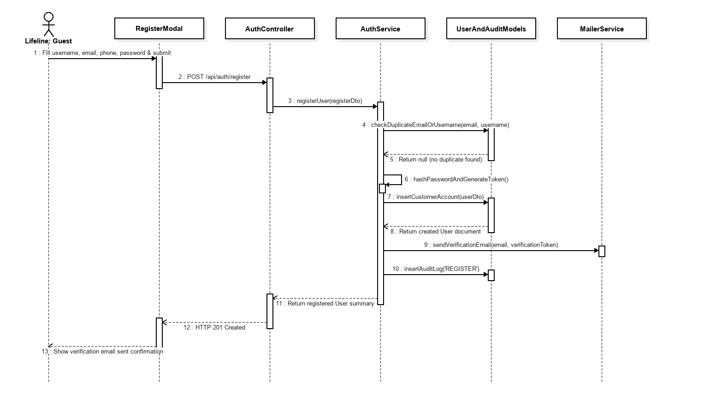

##### UC-06: Login System
User authenticates using email/password credentials or Google OAuth 2.0 to receive a 24-hour JWT access token, subject to 6-attempt lockout policy (BR-FR01, BR-FR02, BR-FR03).

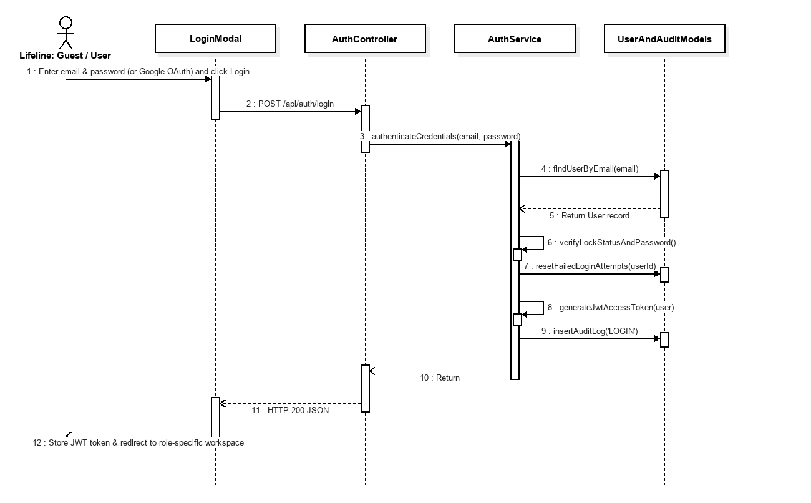

##### UC-07: Reset Forgotten Password
Guest requests a time-limited single-use password reset link sent to their registered email and sets a new bcrypt-hashed password (BR-FR01, BR-FR08).

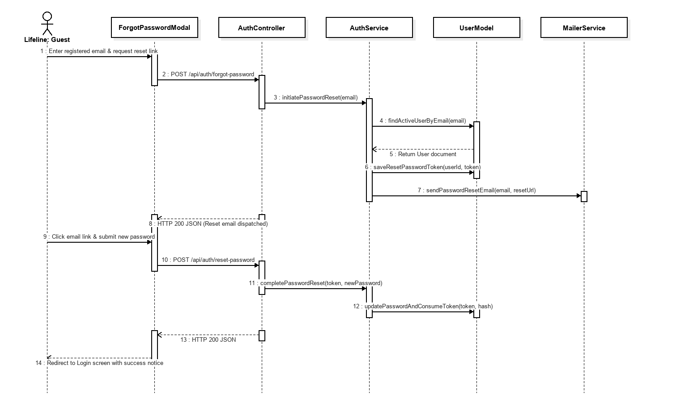

##### UC-08: Logout System
Authenticated user (Customer, Staff, Branch Manager, System Admin) logs out, records an audit entry, and terminates the active client session.

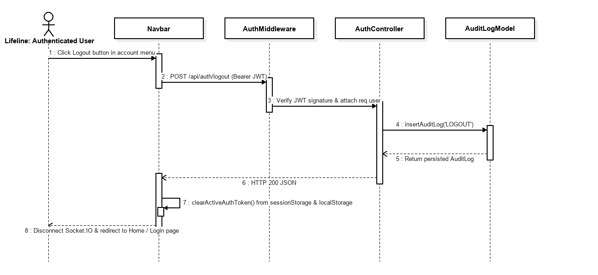

#### d. Database Queries

##### UC-05 — Register Account
```typescript
// 1. Check duplicate email or username
const existingUser = await User.findOne({ $or: [{ email: email.toLowerCase() }, { username }] }).lean();

// 2. Hash password (10 salt rounds - BR-FR01) and create Customer account
const passwordHash = await bcrypt.hash(password, 10);
const newUser = await User.create({
  username,
  email: email.toLowerCase(),
  firstName,
  lastName,
  phoneNumber,
  passwordHash,
  roles: 'Customer',
  identityStatus: 'Unverified',
  isEmailVerified: false,
  emailVerificationToken,
  emailVerificationExpires: new Date(Date.now() + 24 * 3600 * 1000)
});

// 3. Record registration audit trail (BR-FR06)
await AuditLog.create({ userId: newUser._id, action: 'REGISTER', entity: 'User', entityId: newUser._id.toString(), timestamp: new Date() });
```

##### UC-06 — Login System
```typescript
// 1. Lookup user by email including passwordHash
const user = await User.findOne({ email: email.toLowerCase(), isDeleted: false }).select('+passwordHash');

// 2. On failed password match: increment failedLoginAttempts & lock 30 mins if >= 6 (BR-FR02)
await User.updateOne(
  { _id: user._id },
  {
    $inc: { failedLoginAttempts: 1 },
    ...(user.failedLoginAttempts + 1 >= 6 ? { $set: { lockUntil: new Date(Date.now() + 30 * 60 * 1000) } } : {})
  }
);

// 3. On successful login: reset lockout counters & log LOGIN audit event
await User.updateOne({ _id: user._id }, { $set: { failedLoginAttempts: 0, lastLoginAt: new Date() }, $unset: { lockUntil: 1 } });
await AuditLog.create({ userId: user._id, action: 'LOGIN', entity: 'User', entityId: user._id.toString(), timestamp: new Date() });
```

##### UC-07 — Reset Forgotten Password
```typescript
// 1. Store hashed reset token & expiration timestamp on User
await User.updateOne(
  { _id: user._id },
  { $set: { resetPasswordToken: tokenHash, resetPasswordExpires: new Date(Date.now() + 3600 * 1000) } }
);

// 2. Verify valid single-use reset token, update passwordHash & consume token (BR-FR08)
const user = await User.findOneAndUpdate(
  { resetPasswordToken: tokenHash, resetPasswordExpires: { $gt: new Date() } },
  { $set: { passwordHash: newBcryptHash, failedLoginAttempts: 0 }, $unset: { resetPasswordToken: 1, resetPasswordExpires: 1, lockUntil: 1 } },
  { new: true }
);
```

##### UC-08 — Logout System
```typescript
// 1. Record session logout in AuditLog (BR-FR06)
await AuditLog.create({
  userId: req.user._id,
  action: 'LOGOUT',
  entity: 'User',
  entityId: req.user._id.toString(),
  ipAddress: req.ip,
  timestamp: new Date()
});
```

---

### 3. Customer Profile & Account Feature (UC-09 .. UC-11)

Enables authenticated Customers to manage their personal profile and avatar image, upload CCCD/CMND and driving license photos for eKYC identity verification (BR-05, BR-FR07), and change their account password with current credential verification (BR-FR01).

#### a. Class Diagram

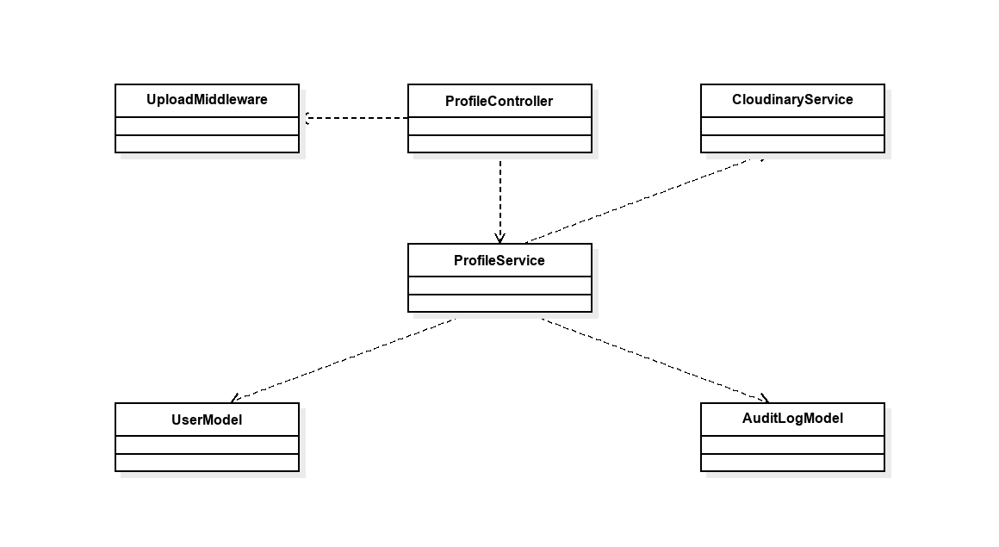

#### b. Class Specifications

##### UploadMiddleware Class
Multer file upload middleware in server/src/core/uploadMiddleware.ts enforcing file format (JPEG, PNG, WebP) and 5MB size limits (BR-FR07).

| No | Method | Description |
|---|---|---|
| 01 | `uploadAvatar()` | Inputs: multipart/form-data field 'avatar'. Outputs: Validated file buffer/path on req.file. Processing: Rejects non-image MIME types or files > 5MB (BR-FR07). |
| 02 | `uploadEkycDocs()` | Inputs: multipart/form-data fields (idCardFront, idCardBack, drivingLicense, selfie). Outputs: req.files map. Processing: Validates up to 4 identity document images. |

##### ProfileController Class
Controller handling customer profile updates, eKYC document submission, and password changes under /api/auth.

| No | Method | Description |
|---|---|---|
| 01 | `updateProfile(req, res, next)` | Inputs: AuthenticatedRequest (firstName, lastName, phoneNumber, gender, dateOfBirth, address, avatar). Outputs: HTTP 200 JSON { data: user }. Processing: Calls ProfileService.updatePersonalInfo(). |
| 02 | `submitEkyc(req, res, next)` | Inputs: AuthenticatedRequest with eKYC images and idCardNumber. Outputs: HTTP 200 JSON { data: user }. Processing: Calls ProfileService.uploadEkycDocuments() and transitions identityStatus to 'Pending'. |
| 03 | `changePassword(req, res, next)` | Inputs: req.body (currentPassword, newPassword). Outputs: HTTP 200 JSON. Processing: Verifies old password and updates hash via ProfileService.updatePassword(). |

##### ProfileService Class
Service logic for customer profile maintenance, eKYC state transitions, and credential updates.

| No | Method | Description |
|---|---|---|
| 01 | `updatePersonalInfo(userId, dto, avatarUrl)` | Inputs: userId, ProfileUpdateDTO, avatarUrl. Outputs: Promise<IUser>. Processing: Updates allowed profile fields on User document and logs audit trail. |
| 02 | `uploadEkycDocuments(userId, filesDto)` | Inputs: userId, EkycSubmissionDTO. Outputs: Promise<IUser>. Processing: Stores Cloudinary/local URLs for CCCD front/back, driving license, and selfie; sets identityStatus='Pending' and ekycConsentAgreed=true. |
| 03 | `updatePassword(userId, oldPwd, newPwd)` | Inputs: userId, oldPwd, newPwd. Outputs: Promise<void>. Processing: Verifies oldPwd against User.passwordHash, hashes newPwd (10 rounds), updates User, and writes AuditLog. |

#### c. Sequence Diagram(s) — 1 Sequence Diagram per Use Case

##### UC-09: Update Personal Profile & Avatar
Customer edits personal information (first/last name, phone, gender, date of birth, address), uploads an avatar photo (<= 5MB), and checks loyalty points balance.

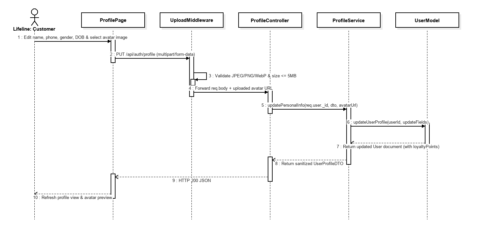

##### UC-10: Submit Identity Verification (eKYC)
Customer uploads front/back photos of CCCD/CMND, driving license, and selfie for eKYC identity verification required before motorbike handover/booking (BR-05, BR-FR07).

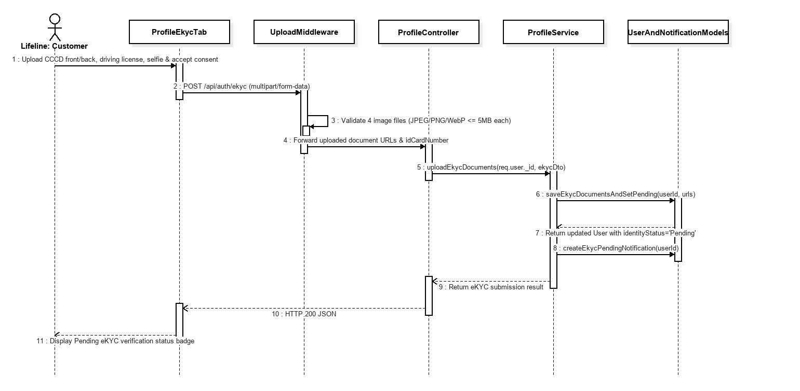

##### UC-11: Change Account Password
Customer updates their current account password after verifying existing credentials (BR-FR01, BR-FR06).

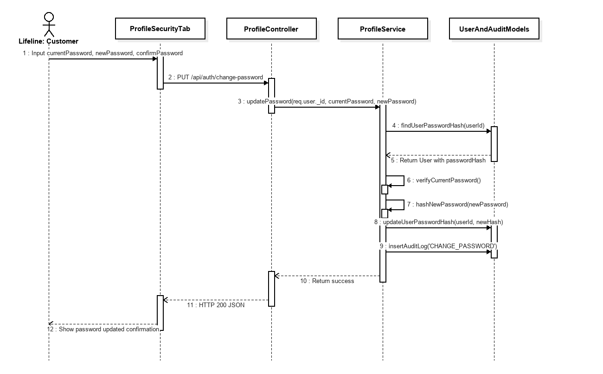

#### d. Database Queries

##### UC-09 — Update Personal Profile & Avatar
```typescript
// 1. Update personal profile fields and avatarUrl
const updatedUser = await User.findByIdAndUpdate(
  req.user._id,
  { $set: { firstName, lastName, phoneNumber, gender, dateOfBirth, address, ...(avatarUrl ? { avatarUrl } : {}) } },
  { new: true, runValidators: true }
).select('-passwordHash');
```

##### UC-10 — Submit Identity Verification (eKYC)
```typescript
// 1. Save eKYC document URLs and transition identityStatus to 'Pending'
const user = await User.findByIdAndUpdate(
  req.user._id,
  {
    $set: {
      idCardNumber,
      idCardFrontUrl,
      idCardBackUrl,
      drivingLicenseUrl,
      selfieUrl,
      ekycConsentAgreed: true,
      ekycConsentDate: new Date(),
      identityStatus: 'Pending'
    }
  },
  { new: true }
);

// 2. Create notification for customer & audit log entry
await Notification.create({ userId: req.user._id, type: 'SYSTEM', title: 'Hồ sơ eKYC đang chờ duyệt', body: 'Hệ thống đã tiếp nhận ảnh CCCD và GPLX của bạn.' });
await AuditLog.create({ userId: req.user._id, action: 'SUBMIT_EKYC', entity: 'User', entityId: req.user._id.toString(), timestamp: new Date() });
```

##### UC-11 — Change Account Password
```typescript
// 1. Fetch current passwordHash for verification
const user = await User.findById(req.user._id).select('+passwordHash');
const isMatch = await bcrypt.compare(currentPassword, user.passwordHash);

// 2. Hash new password with 10 salt rounds and update User
const newPasswordHash = await bcrypt.hash(newPassword, 10);
await User.updateOne({ _id: req.user._id }, { $set: { passwordHash: newPasswordHash } });
await AuditLog.create({ userId: req.user._id, action: 'CHANGE_PASSWORD', entity: 'User', entityId: req.user._id.toString(), timestamp: new Date() });
```

---

### 4. Booking & Payment Feature (UC-12 .. UC-19)

Implements the core rental workflow: favorite motorbike bookmarking (Wishlist), GPS-based nearest branch search, rental order creation with overlapping date prevention (BR-02), minimum 24h duration (BR-03), MV-XXXXXX booking code generation (BR-04), one-way surcharge (BR-07), 30% online deposit payment via VNPay (BR-01), order cancellation with 24h refund rules (BR-06), active rental extension, real-time Socket.IO status tracking, and PDFKit invoice generation.

#### a. Class Diagram

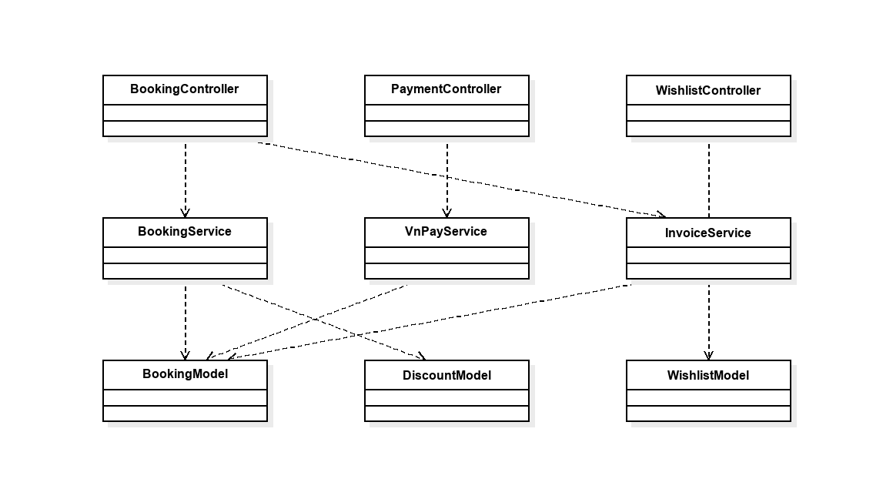

#### b. Class Specifications

##### BookingController Class
Express HTTP controller managing rental order creation, cancellation, extension, history tracking, and PDF invoice streaming under /api/bookings.

| No | Method | Description |
|---|---|---|
| 01 | `createBooking(req, res, next)` | Inputs: AuthenticatedRequest (vehicleId, pickupBranchId, returnBranchId, pickupDateTime, returnDateTime, discountCode, paymentMethod, eSignatureUrl). Outputs: HTTP 201 JSON { booking, paymentUrl }. Processing: Calls BookingService.createBooking(). |
| 02 | `cancelBooking(req, res, next)` | Inputs: req.params.id, req.body.cancelReason. Outputs: HTTP 200 JSON { data: booking }. Processing: Invokes BookingService.cancelOrder() applying BR-06 refund policy. |
| 03 | `extendBooking(req, res, next)` | Inputs: req.params.id, req.body.newReturnDateTime. Outputs: HTTP 200 JSON { data: updatedBooking }. Processing: Validates non-overlapping extension window and updates returnDateTime and balance via BookingService.extendRental(). |
| 04 | `getMyBookings(req, res, next)` | Inputs: req.user._id, req.query.status. Outputs: HTTP 200 JSON { data: BookingTimelineDTO[] }. Processing: Fetches customer rental history with 4-angle check-in/out photos. |
| 05 | `downloadInvoice(req, res, next)` | Inputs: req.params.id, req.user. Outputs: application/pdf binary stream. Processing: Calls InvoiceService.streamBookingInvoicePdf(). |

##### PaymentController Class
Controller handling VNPay payment URL creation, Server-to-Server IPN webhook verification, and browser return verification under /api/payments.

| No | Method | Description |
|---|---|---|
| 01 | `createPaymentUrl(req, res, next)` | Inputs: req.body (bookingId, paymentType: 'deposit' | 'full'). Outputs: HTTP 200 JSON { paymentUrl }. Processing: Calls VnPayService.buildPaymentUrl(). |
| 02 | `vnpayIpn(req, res, next)` | Inputs: req.query (vnp_TxnRef, vnp_Amount, vnp_ResponseCode, vnp_TransactionNo, vnp_SecureHash). Outputs: HTTP 200 JSON { RspCode, Message }. Processing: Verifies HMAC-SHA512 signature and updates Booking depositPaid=true, status='Confirmed' via VnPayService.processVnPayIpn(). |

##### WishlistController Class
Controller managing customer favorite motorbike bookmarks under /api/wishlist.

| No | Method | Description |
|---|---|---|
| 01 | `getWishlist(req, res, next)` | Inputs: req.user._id. Outputs: HTTP 200 JSON { items }. Processing: Retrieves populated Wishlist items for the customer. |
| 02 | `toggleWishlistItem(req, res, next)` | Inputs: req.body.vehicleId. Outputs: HTTP 200 JSON { bookmarked: boolean }. Processing: Adds or removes vehicleId from customer's Wishlist. |

##### BookingService Class
Central domain service enforcing all booking state machine transitions (BR-08), conflict detection (BR-02), pricing & promo calculations (BR-01, BR-07), and cancellation rules (BR-06).

| No | Method | Description |
|---|---|---|
| 01 | `createBooking(userId, dto)` | Inputs: userId, CreateBookingDTO. Outputs: Promise<IBooking>. Processing: Verifies eKYC status (BR-05), checks overlapping bookings (BR-02), validates Discount voucher, calculates totalAmount + 50,000 VND one-way fee (BR-07) + 30% depositAmount (BR-01), generates MV-XXXXXX code (BR-04), and saves Booking. |
| 02 | `cancelOrder(bookingId, userId, reason)` | Inputs: bookingId, userId, reason. Outputs: Promise<IBooking>. Processing: Verifies status is before handover, computes refundAmount (>24h: 100%, <24h: 50% forfeited per BR-06), restores Discount usedCount, updates status to 'Cancelled', and emits Socket.IO update. |
| 03 | `extendRental(bookingId, userId, newReturnDate)` | Inputs: bookingId, userId, newReturnDate. Outputs: Promise<IBooking>. Processing: Checks future booking conflicts on the same vehicleId, computes added rental days/amount, and increments totalAmount and remainingAmount. |

##### VnPayService Class
Payment gateway integration service in server/src/modules/payment/vnpayService.ts implementing VNPay v2.1.0 HMAC-SHA512 signing and IPN reconciliation.

| No | Method | Description |
|---|---|---|
| 01 | `buildPaymentUrl(booking, ipAddr, mode)` | Inputs: IBooking, client IP, mode ('deposit' | 'full'). Outputs: Signed VNPay redirect URL string. Processing: Sorts vnp_* parameters alphabetically and signs query string with VNP_HASHSECRET using HMAC-SHA512. |
| 02 | `processVnPayIpn(queryParams)` | Inputs: VNPay IPN query object. Outputs: Promise<{ RspCode: string, Message: string }>. Processing: Validates checksum, checks idempotency on Payment collection, updates Booking status='Confirmed', depositPaid=true, and records Payment transaction. |

##### InvoiceService Class
PDF generation service in server/src/modules/booking/invoiceService.ts using PDFKit to render A4 electronic rental invoices.

| No | Method | Description |
|---|---|---|
| 01 | `streamBookingInvoicePdf(bookingId, requestingUser, res)` | Inputs: bookingId, requestingUser, Express Response. Outputs: Streams PDF document. Processing: Populates Booking with customer, vehicle, and branch data, verifies access permissions, and renders itemized table of rental charges, discounts, penalties, and deposit settlement. |

#### c. Sequence Diagram(s) — 1 Sequence Diagram per Use Case

##### UC-12: Bookmark Favorite Vehicles (Wishlist)
Customer saves motorbikes to their personal favorites wishlist or removes bookmarked vehicles.

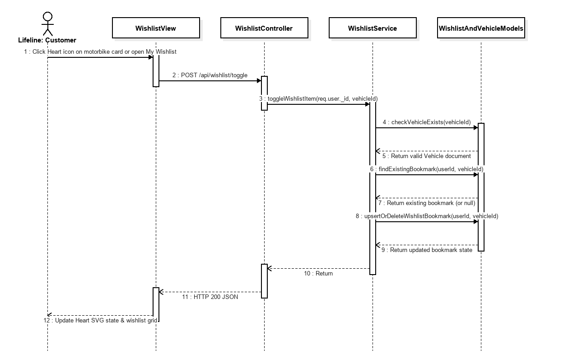

##### UC-13: Find Nearest Branches by GPS
Customer locates available motorbikes at branches nearest to their current GPS coordinates using spherical Haversine distance calculation.

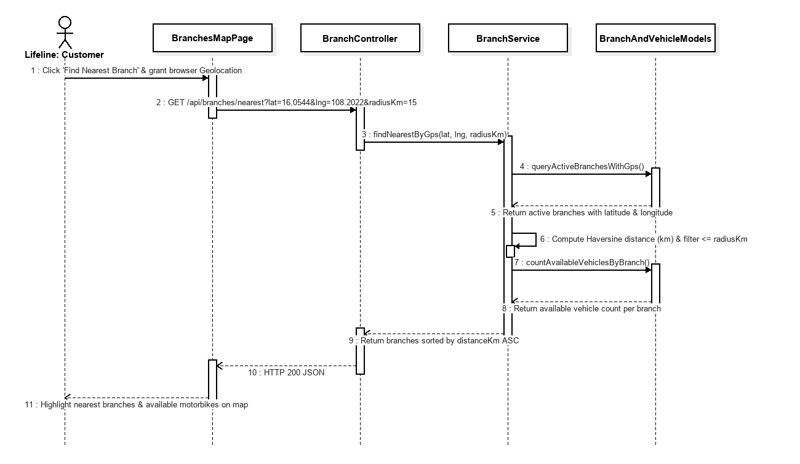

##### UC-14: Book a Rental
Customer creates a rental order by selecting vehicle, pickup/return branches (with 50,000 VND one-way surcharge per BR-07), rental dates (>= 24h per BR-03), optional promo code, and signing the e-contract (BR-01..BR-08).

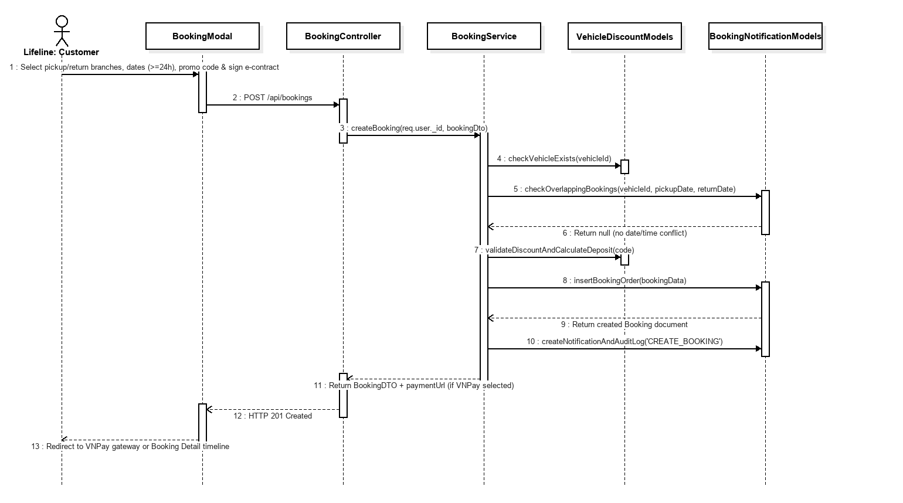

##### UC-15: Pay Rental Deposit & Balance
Customer pays 30% deposit or 100% full amount online via VNPay/VietQR, or settles the remaining 70% at the branch counter during pickup (BR-01, BR-08).

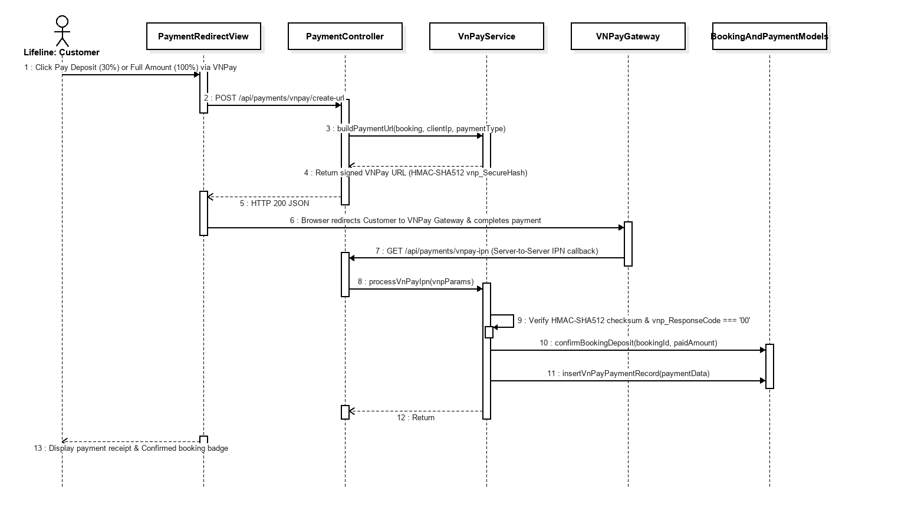

##### UC-16: Cancel Rental Order
Customer cancels a pending/confirmed booking before handover with a reason and requests a deposit refund governed by BR-06 (>24h before pickup: 100% refund; <24h: 50% deposit forfeited).

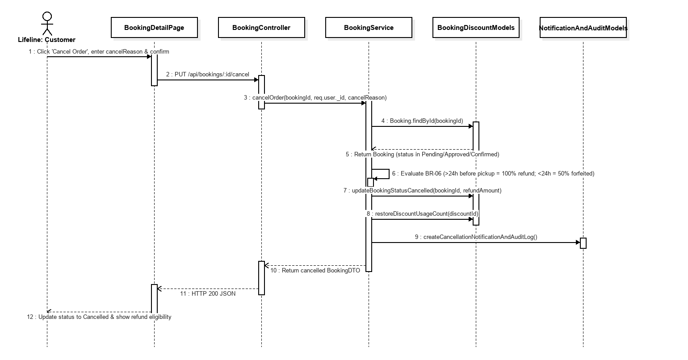

##### UC-17: Extend Rental Period
Customer requests to extend the scheduled return date/time of an active rental after verifying no overlapping future bookings exist on the same motorbike (BR-02).

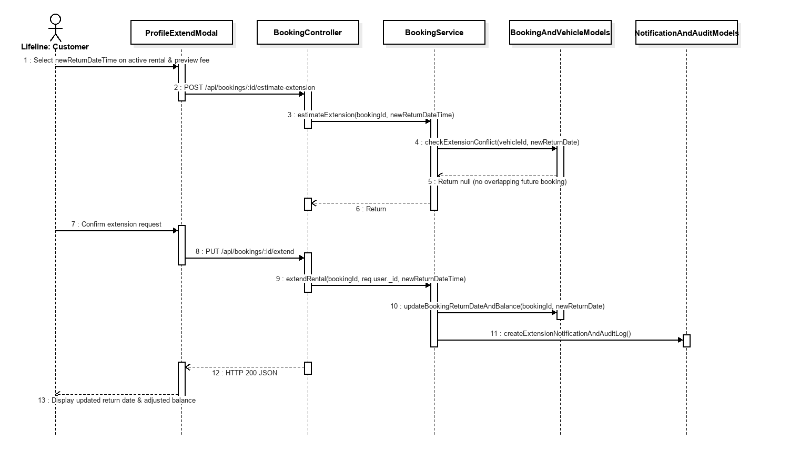

##### UC-18: Track Rental Orders & History
Customer monitors real-time order status via Socket.IO, checks past rental history filtered by status tab, and inspects 4-angle check-in/check-out vehicle photos.

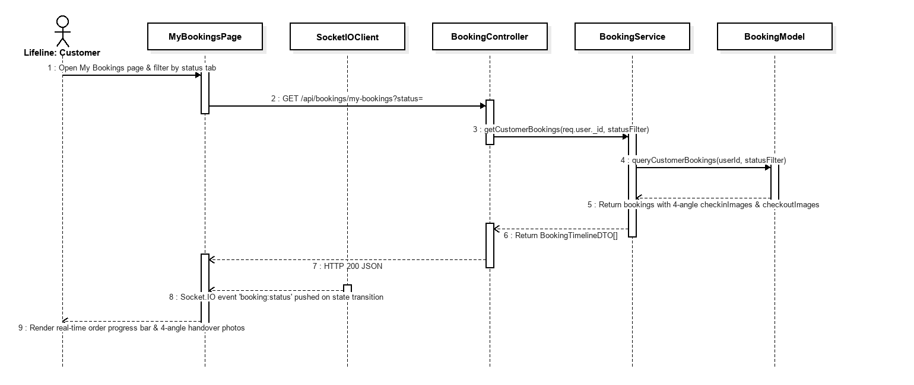

##### UC-19: Download Invoice PDF
Customer generates and downloads a formatted A4 PDF invoice/receipt for a rental order.

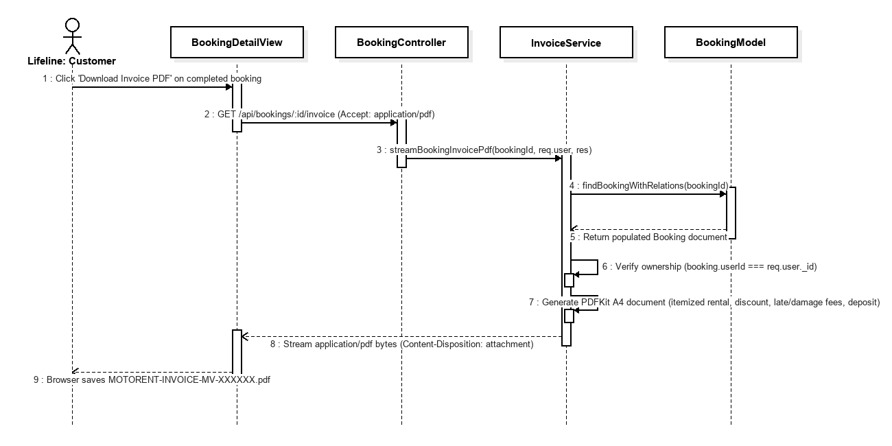

#### d. Database Queries

##### UC-12 — Bookmark Favorite Vehicles (Wishlist)
```typescript
// 1. Check if vehicle is already bookmarked by customer
const existing = await Wishlist.findOne({ userId: req.user._id, vehicleId });

// 2. Toggle bookmark (remove if exists, create if not)
if (existing) {
  await Wishlist.deleteOne({ _id: existing._id });
} else {
  await Wishlist.create({ userId: req.user._id, vehicleId });
}

// 3. List customer's bookmarked motorbikes
const items = await Wishlist.find({ userId: req.user._id })
  .populate({ path: 'vehicleId', populate: ['branchId', 'category'] })
  .sort({ createdAt: -1 })
  .lean();
```

##### UC-13 — Find Nearest Branches by GPS
```typescript
// 1. Fetch active branches with valid GPS coordinates
const branches = await Branch.find({
  isActive: true,
  latitude: { $ne: null },
  longitude: { $ne: null }
}).lean();

// 2. Aggregate available vehicle counts per branch
const availableByBranch = await Vehicle.aggregate([
  { $match: { isDeleted: false, status: 'Available' } },
  { $group: { _id: '$branchId', availableVehicles: { $sum: 1 } } }
]);
```

##### UC-14 — Book a Rental
```typescript
// 1. Check overlapping active bookings for the selected vehicle (BR-02)
const overlappingBooking = await Booking.findOne({
  vehicleId,
  status: { $in: ['Pending', 'Approved', 'Confirmed', 'Ongoing'] },
  pickupDateTime: { $lt: new Date(returnDateTime) },
  returnDateTime: { $gt: new Date(pickupDateTime) }
}).lean();

// 2. Validate and atomically increment discount code usage
const discount = await Discount.findOneAndUpdate(
  {
    code: discountCode.toUpperCase(),
    isActive: true,
    startDate: { $lte: now },
    endDate: { $gte: now },
    $expr: { $lt: ['$usedCount', '$usageLimit'] }
  },
  { $inc: { usedCount: 1 } },
  { new: true }
);

// 3. Create Booking record with generated MV-XXXXXX code (BR-04) and 30% deposit (BR-01)
const booking = await Booking.create({
  bookingCode,
  userId: req.user._id,
  vehicleId,
  pickupBranchId,
  returnBranchId,
  pickupDateTime,
  returnDateTime,
  totalAmount,
  depositAmount: Math.round(totalAmount * 0.3),
  remainingAmount: totalAmount - Math.round(totalAmount * 0.3),
  discountId: discount?._id,
  discountAmount,
  eSignatureUrl,
  status: 'Pending',
  paymentExpiresAt: new Date(Date.now() + 15 * 60 * 1000)
});
```

##### UC-15 — Pay Rental Deposit & Balance
```typescript
// 1. Confirm booking deposit upon verified VNPay IPN callback (vnp_ResponseCode === '00')
const updatedBooking = await Booking.findOneAndUpdate(
  { _id: bookingId, status: { $in: ['Pending', 'Approved'] } },
  {
    $set: {
      status: 'Confirmed',
      depositPaid: true,
      paidAmount: paidVnd,
      remainingAmount: Math.max(0, booking.totalAmount - paidVnd),
      isPaid: paidVnd >= booking.totalAmount,
      vnpTransactionNo: queryParams.vnp_TransactionNo
    }
  },
  { new: true }
);

// 2. Persist VNPay transaction record for financial reconciliation (UC-50)
await Payment.create({
  bookingId,
  userId: updatedBooking.userId,
  amount: paidVnd,
  paymentMethod: 'VNPay',
  paymentType: paidVnd >= updatedBooking.totalAmount ? 'Full' : 'Deposit',
  vnpTxnRef: queryParams.vnp_TxnRef,
  vnpTransactionNo: queryParams.vnp_TransactionNo,
  vnpResponseCode: queryParams.vnp_ResponseCode,
  status: 'Success'
});
```

##### UC-16 — Cancel Rental Order
```typescript
// 1. Update booking status to Cancelled and record BR-06 refund calculation
const cancelledBooking = await Booking.findOneAndUpdate(
  { _id: bookingId, userId: req.user._id, status: { $in: ['Pending', 'Approved', 'Confirmed'] } },
  {
    $set: {
      status: 'Cancelled',
      cancelReason,
      cancelledAt: new Date(),
      refundAmount,
      refundStatus: refundAmount > 0 ? 'Requested' : 'None'
    }
  },
  { new: true }
);

// 2. Release applied discount voucher and cancel pending pickup reminders
if (cancelledBooking.discountId) {
  await Discount.findByIdAndUpdate(cancelledBooking.discountId, { $inc: { usedCount: -1 } });
}
await BookingReminder.updateMany({ bookingId, status: 'Pending' }, { $set: { status: 'Cancelled' } });
```

##### UC-17 — Extend Rental Period
```typescript
// 1. Check if another booking conflicts with the requested extension window (BR-02)
const conflict = await Booking.findOne({
  vehicleId: booking.vehicleId,
  _id: { $ne: booking._id },
  status: { $in: ['Pending', 'Approved', 'Confirmed', 'Ongoing'] },
  pickupDateTime: { $lt: new Date(newReturnDateTime) },
  returnDateTime: { $gt: booking.returnDateTime }
}).lean();

// 2. Update returnDateTime and increment totalAmount and remainingAmount
const updated = await Booking.findByIdAndUpdate(
  booking._id,
  {
    $set: { returnDateTime: new Date(newReturnDateTime), isPaid: false },
    $inc: { totalAmount: addedAmount, remainingAmount: addedAmount }
  },
  { new: true }
);
```

##### UC-18 — Track Rental Orders & History
```typescript
// 1. Query customer's bookings with vehicle and branch details
const bookings = await Booking.find({
  userId: req.user._id,
  ...(status && status !== 'All' ? { status } : {})
})
  .populate('vehicleId', 'vehicleModel brand licensePlate images dailyPrice')
  .populate('pickupBranchId', 'name code address phone')
  .populate('returnBranchId', 'name code address phone')
  .sort({ createdAt: -1 })
  .lean();
```

##### UC-19 — Download Invoice PDF
```typescript
// 1. Fetch complete booking record with populated relations for PDF invoice rendering
const booking = await Booking.findById(bookingId)
  .populate('userId', 'firstName lastName username email phoneNumber')
  .populate('vehicleId', 'vehicleModel brand licensePlate transmissionType fuelType dailyPrice')
  .populate('pickupBranchId', 'name code address phone email')
  .populate('returnBranchId', 'name code address phone email');
```

---

### 5. Review, Complaint & Communication Feature (UC-20 .. UC-22)

Provides post-rental customer engagement and real-time support: 1-to-1 verified booking reviews and star ratings (Feedback), service complaint submission and resolution timeline tracking (Complaint, ComplaintResponse, ComplaintStatusLog), and real-time Socket.IO live chat between customers and branch staff (Conversation, Message).

#### a. Class Diagram

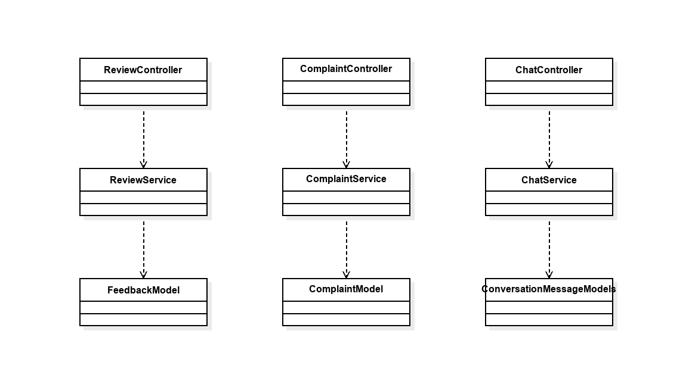

#### b. Class Specifications

##### ReviewController Class
Controller handling customer 1-5 star reviews and photo attachments for completed bookings under /api/reviews.

| No | Method | Description |
|---|---|---|
| 01 | `createReview(req, res, next)` | Inputs: AuthenticatedRequest (bookingId, rating, comment, photos). Outputs: HTTP 201 JSON { data: review }. Processing: Calls ReviewService.submitFeedback(). |
| 02 | `updateReview(req, res, next)` | Inputs: req.params.id, req.body (rating, comment, existingPhotos). Outputs: HTTP 200 JSON. Processing: Updates customer's own review and recalculates vehicle average rating. |
| 03 | `deleteReview(req, res, next)` | Inputs: req.params.id, req.user._id. Outputs: HTTP 200 JSON. Processing: Deletes review and updates vehicle rating average. |

##### ComplaintController Class
Controller managing customer complaint tickets and status history under /api/complaints.

| No | Method | Description |
|---|---|---|
| 01 | `createComplaint(req, res, next)` | Inputs: AuthenticatedRequest (bookingId, branchId, title, category, description). Outputs: HTTP 201 JSON { data: complaint }. Processing: Calls ComplaintService.submitComplaint(). |
| 02 | `getMyComplaints(req, res, next)` | Inputs: req.user._id. Outputs: HTTP 200 JSON { items }. Processing: Retrieves customer's submitted complaints and status logs. |
| 03 | `getComplaintDetail(req, res, next)` | Inputs: req.params.id. Outputs: HTTP 200 JSON { complaint, responses, statusLogs }. Processing: Returns full complaint thread. |

##### ChatController Class
Controller and Socket.IO event handler managing real-time support conversations under /api/chat.

| No | Method | Description |
|---|---|---|
| 01 | `getOrCreateConversation(req, res, next)` | Inputs: req.user._id, req.body.branchId. Outputs: HTTP 200 JSON { conversation }. Processing: Opens or resumes active Conversation session. |
| 02 | `sendMessage(req, res, next)` | Inputs: req.body (conversationId, content). Outputs: HTTP 201 JSON { message }. Processing: Saves Message document and broadcasts via Socket.IO. |

##### ReviewService Class
Service enforcing 1-to-1 booking review eligibility and recalculating motorbike star ratings.

| No | Method | Description |
|---|---|---|
| 01 | `submitFeedback(userId, dto)` | Inputs: userId, CreateReviewDTO. Outputs: Promise<IFeedback>. Processing: Verifies Booking belongs to userId and has status='Completed', creates Feedback (unique bookingId), and recalculates Vehicle averageRating. |

##### ComplaintService Class
Service managing complaint lifecycle, staff/manager responses, and status transition logs.

| No | Method | Description |
|---|---|---|
| 01 | `submitComplaint(userId, dto)` | Inputs: userId, CreateComplaintDTO. Outputs: Promise<IComplaint>. Processing: Resolves branchId from Booking, creates Complaint with status='Open', inserts initial ComplaintStatusLog, and notifies branch staff. |

##### ChatService Class
Real-time messaging service coordinating MongoDB persistence (Conversation, Message) and Socket.IO room broadcasting.

| No | Method | Description |
|---|---|---|
| 01 | `persistAndEmitMessage(convId, senderId, content)` | Inputs: conversationId, senderId, content. Outputs: Promise<IMessage>. Processing: Inserts Message document, updates Conversation.lastMessageAt, and emits 'chat:new_message' to conversation room. |

#### c. Sequence Diagram(s) — 1 Sequence Diagram per Use Case

##### UC-20: Rate & Review Rented Vehicles
Customer submits a 1-5 star review with photos for a completed rental (1:1 with Booking), or edits/deletes their submitted review.


##### UC-21: Report & Track Service Complaints
Customer submits a complaint about a booking or branch experience and tracks its resolution progress and staff responses.

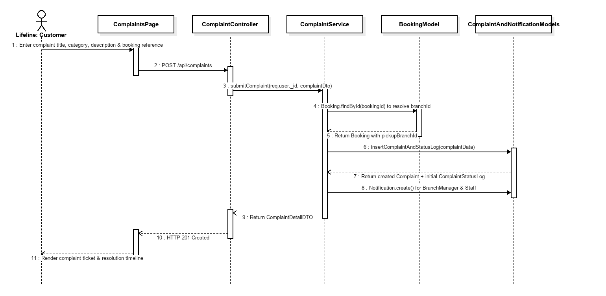

##### UC-22: Chat Live with Branch Staff
Customer exchanges real-time support messages with branch staff via Socket.IO.

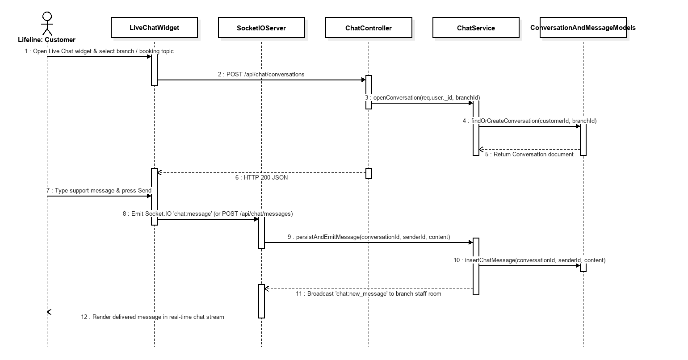

#### d. Database Queries

##### UC-20 — Rate & Review Rented Vehicles
```typescript
// 1. Verify rental booking is Completed and belongs to Customer
const completedBooking = await Booking.findOne({ _id: bookingId, userId: req.user._id, status: 'Completed' }).lean();

// 2. Create 1:1 Feedback record and recalculate vehicle average rating
const feedback = await Feedback.create({ bookingId, userId: req.user._id, vehicleId: completedBooking.vehicleId, rating, comment, photos });
const stats = await Feedback.aggregate([
  { $match: { vehicleId: completedBooking.vehicleId } },
  { $group: { _id: '$vehicleId', avgRating: { $avg: '$rating' }, reviewCount: { $sum: 1 } } }
]);
await Vehicle.findByIdAndUpdate(completedBooking.vehicleId, { $set: { rating: stats[0]?.avgRating || 5, reviewCount: stats[0]?.reviewCount || 1 } });
```

##### UC-21 — Report & Track Service Complaints
```typescript
// 1. Create Complaint ticket and initial status log entry
const complaint = await Complaint.create({
  customerId: req.user._id,
  bookingId,
  branchId,
  title,
  description,
  category,
  status: 'Open'
});
await ComplaintStatusLog.create({
  complaintId: complaint._id,
  fromStatus: null,
  toStatus: 'Open',
  changedBy: req.user._id,
  note: 'Khách hàng khởi tạo khiếu nại'
});
```

##### UC-22 — Chat Live with Branch Staff
```typescript
// 1. Upsert active Conversation for customer and branch
const conversation = await Conversation.findOneAndUpdate(
  { customerId: req.user._id, branchId },
  { $setOnInsert: { customerId: req.user._id, branchId, status: 'Active' } },
  { upsert: true, new: true }
);

// 2. Persist chat Message and update conversation timestamp
const message = await Message.create({
  conversationId: conversation._id,
  senderId: req.user._id,
  content,
  isRead: false
});
await Conversation.findByIdAndUpdate(conversation._id, { $set: { lastMessage: content, lastMessageAt: new Date() } });
```

---

### 6. Notifications & Loyalty Feature (UC-23 .. UC-25)

Manages multi-channel customer notifications (in-app Socket.IO push, email confirmations, automated 24h/2h pickup & return reminders via BookingReminder), loyalty point accumulation (1 point per 10,000 VND spent on completed rentals per BR-12) and voucher redemption, and referral code sharing & promotional subscriptions.

#### a. Class Diagram

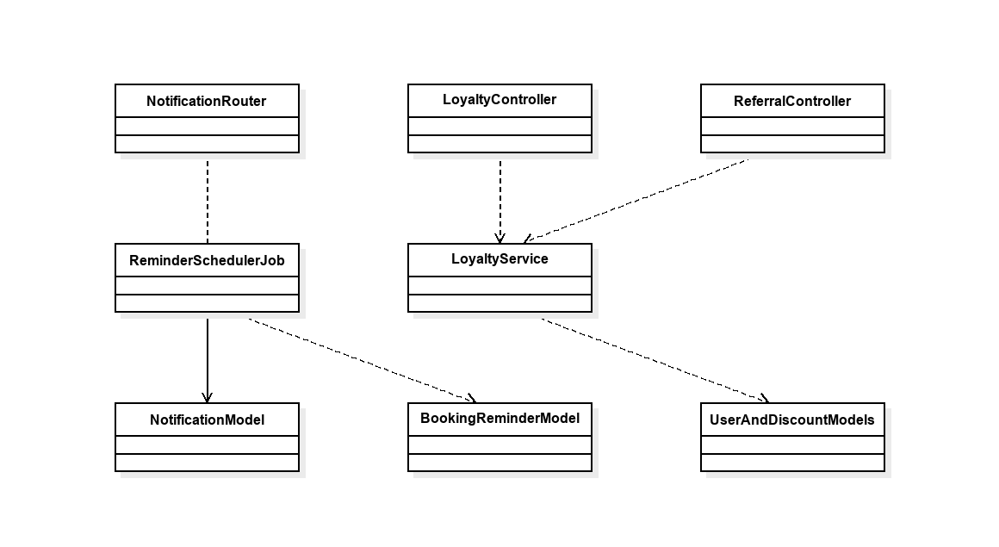

#### b. Class Specifications

##### NotificationRouter Class
Express router in server/src/modules/system/systemRoutes.ts managing in-app notification retrieval and read/unread state.

| No | Method | Description |
|---|---|---|
| 01 | `getNotifications(req, res, next)` | Inputs: AuthenticatedRequest. Outputs: HTTP 200 JSON { items, unreadCount }. Processing: Queries latest 30 Notification records for req.user._id. |
| 02 | `markRead(req, res, next)` | Inputs: req.params.id. Outputs: HTTP 200 JSON. Processing: Sets isRead=true on matching Notification. |
| 03 | `markAllRead(req, res, next)` | Inputs: req.user._id. Outputs: HTTP 200 JSON. Processing: Bulk updates all unread notifications for the user to isRead=true. |

##### ReminderSchedulerJob Class
Background cron job dispatching scheduled 24-hour and 2-hour pickup/return reminders from BookingReminder.

| No | Method | Description |
|---|---|---|
| 01 | `dispatchDueReminders()` | Inputs: Current wall-clock timestamp. Outputs: Promise<number>. Processing: Polls BookingReminder(status='Pending', scheduledAt <= now), creates in-app Notification, sends email/SMS alert, and updates status='Sent'. |

##### LoyaltyService Class
Service managing BR-12 loyalty point awards, point-to-voucher redemptions, and referral bonuses.

| No | Method | Description |
|---|---|---|
| 01 | `awardPointsOnCompletion(userId, netAmount)` | Inputs: userId, netAmount (VND). Outputs: Promise<number>. Processing: Calculates floor(netAmount / 10000) points (BR-12) and increments User.loyaltyPoints. |
| 02 | `redeemVoucher(userId, pointsCost)` | Inputs: userId, pointsCost. Outputs: Promise<IDiscount>. Processing: Atomically deducts pointsCost from User.loyaltyPoints and generates a single-use Discount voucher code. |

#### c. Sequence Diagram(s) — 1 Sequence Diagram per Use Case

##### UC-23: Receive Booking Alerts & Reminders
Customer receives in-app push notifications, email confirmations, and automated SMS/email pickup and return reminders (24h and 2h prior).

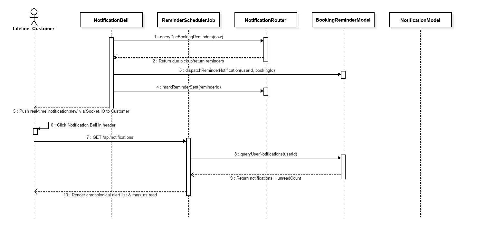

##### UC-24: Earn & Redeem Loyalty Points
Customer accumulates loyalty points upon rental completion (1 pt per 10,000 VND per BR-12) and redeems points for discount vouchers.

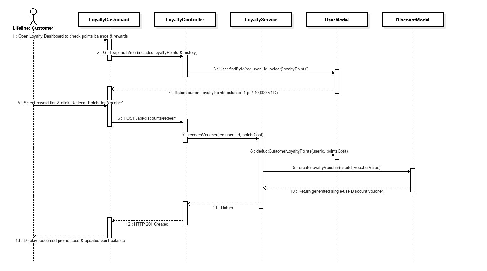

##### UC-25: Refer Friends & Subscribe Promos
Customer shares referral codes for bonus points and opts in to promotional offers.

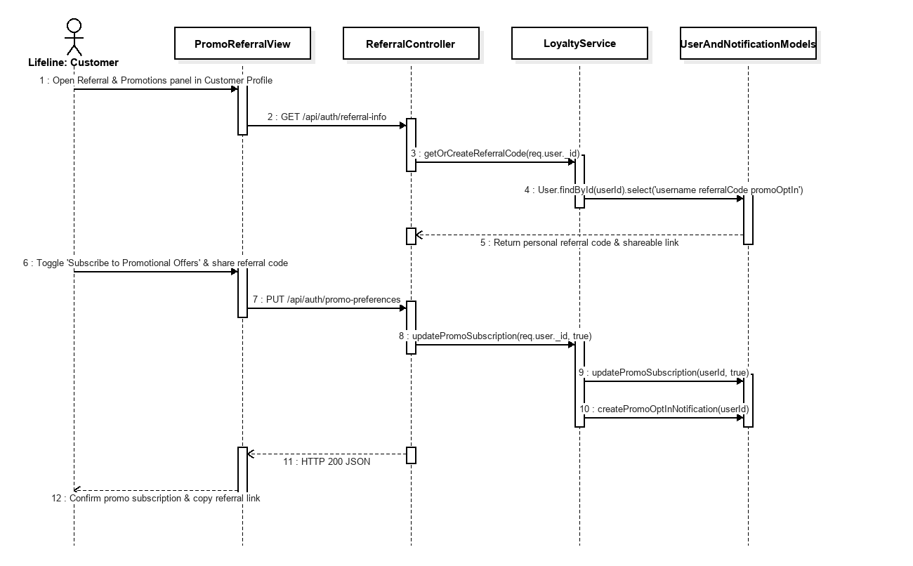

#### d. Database Queries

##### UC-23 — Receive Booking Alerts & Reminders
```typescript
// 1. Poll due pickup/return reminders in background cron job
const dueReminders = await BookingReminder.find({
  status: 'Pending',
  scheduledAt: { $lte: new Date() }
}).populate('bookingId');

// 2. Create in-app notification and mark reminder as Sent
await Notification.create({
  userId: booking.userId,
  type: 'REMINDER',
  title: 'Nhắc lịch nhận/trả xe MOTORENT',
  body: `Đơn thuê xe ${booking.bookingCode} sắp đến giờ hẹn tại chi nhánh.`,
  isRead: false
});
await BookingReminder.updateOne({ _id: reminder._id }, { $set: { status: 'Sent', sentAt: new Date() } });

// 3. Fetch customer's notification feed and mark read
const items = await Notification.find({ userId: req.user._id }).sort({ createdAt: -1 }).limit(30);
await Notification.updateMany({ userId: req.user._id, isRead: false }, { $set: { isRead: true } });
```

##### UC-24 — Earn & Redeem Loyalty Points
```typescript
// 1. Atomically deduct loyalty points from Customer account
const updatedUser = await User.findOneAndUpdate(
  { _id: req.user._id, loyaltyPoints: { $gte: pointsCost } },
  { $inc: { loyaltyPoints: -pointsCost } },
  { new: true }
);

// 2. Generate personal single-use Discount voucher code
const voucher = await Discount.create({
  code: `RW-${crypto.randomBytes(3).toString('hex').toUpperCase()}`,
  description: `Voucher đổi từ ${pointsCost} điểm thưởng Loyalty`,
  discountAmount: voucherValueVnd,
  minOrderValue: 0,
  startDate: new Date(),
  endDate: new Date(Date.now() + 30 * 24 * 3600 * 1000),
  usageLimit: 1,
  usedCount: 0,
  isActive: true
});
```

##### UC-25 — Refer Friends & Subscribe Promos
```typescript
// 1. Update promotional subscription preference & referral tracking on User
const user = await User.findByIdAndUpdate(
  req.user._id,
  { $set: { promoOptIn: Boolean(promoOptIn) } },
  { new: true }
).select('username email loyaltyPoints promoOptIn');
```

---

### 7. Counter Desk Operations Feature (UC-26 .. UC-32)

Provides branch Staff with on-site counter workspace operations: inspecting the branch rental order queue and customer eKYC documents, executing the 5-point vehicle handover Check-in (BR-09, BR-10, 70% counter balance settlement), processing vehicle return Check-out with 4-angle photo comparison and loyalty point awards (BR-12), recording damage incidents and late return fees (30,000 VND/hour per BR-11), logging maintenance tickets, resolving branch complaints, and replying to live customer chats.

#### a. Class Diagram

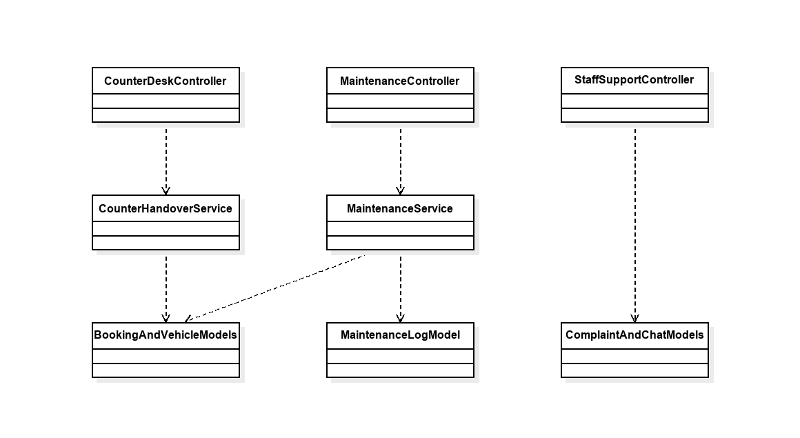

#### b. Class Specifications

##### CounterDeskController Class
Controller managing branch rental queue inspection, Check-in handover, Check-out return, and counter penalty settlement under /api/bookings.

| No | Method | Description |
|---|---|---|
| 01 | `getBranchQueue(req, res, next)` | Inputs: AuthenticatedRequest (branchId, status, queueFilter, searchCode). Outputs: HTTP 200 JSON { bookings, orderCounts }. Processing: Calls CounterHandoverService.listBranchBookings() scoped to staff's assigned branch (BR-14). |
| 02 | `checkinVehicle(req, res, next)` | Inputs: req.params.id, req.body (startOdometer, startFuelLevel, checkinImages, eSignatureUrl, accessoriesConfirmed). Outputs: HTTP 200 JSON { data: booking }. Processing: Executes 5-point handover verification and sets Booking='Ongoing', Vehicle='Rented'. |
| 03 | `checkoutVehicle(req, res, next)` | Inputs: req.params.id, req.body (endOdometer, endFuelLevel, checkoutImages, hasDamage, damageFee, damageNotes). Outputs: HTTP 200 JSON { data: booking }. Processing: Calculates lateFee (BR-11), updates Booking='Completed', awards loyalty points (BR-12), and updates Vehicle status. |

##### MaintenanceController Class
Controller handling vehicle maintenance ticket creation and completion under /api/fleet/maintenance.

| No | Method | Description |
|---|---|---|
| 01 | `createMaintenanceTicket(req, res, next)` | Inputs: req.body (vehicleId, description, cost, odometerAtService). Outputs: HTTP 201 JSON { data: log }. Processing: Flags Vehicle status='Maintenance' and creates MaintenanceLog. |
| 02 | `getBranchMaintenanceLogs(req, res, next)` | Inputs: req.user.branchId. Outputs: HTTP 200 JSON { items }. Processing: Lists maintenance history for the branch. |

##### StaffSupportController Class
Controller enabling branch staff to resolve assigned complaints and respond to customer live chat sessions.

| No | Method | Description |
|---|---|---|
| 01 | `resolveBranchComplaint(req, res, next)` | Inputs: req.params.id, req.body (status, resolutionNotes, responseMessage). Outputs: HTTP 200 JSON. Processing: Appends ComplaintResponse, logs status transition, and updates Complaint status. |
| 02 | `replyCustomerChat(req, res, next)` | Inputs: req.body (conversationId, content). Outputs: HTTP 201 JSON. Processing: Saves staff Message and emits Socket.IO event to customer. |

##### CounterHandoverService Class
Domain service implementing Check-in (BR-09, BR-10), Check-out (BR-11, BR-12, BR-15), and counter payment settlement.

| No | Method | Description |
|---|---|---|
| 01 | `performCheckin(bookingId, staffId, dto)` | Inputs: bookingId, staffId, CheckinDTO. Outputs: Promise<IBooking>. Processing: Validates 4-angle checkinImages, startOdometer, fuel level, 2 helmets/2 raincoats/1 phone mount (BR-10), collects remaining 70% counter balance, transitions Booking to 'Ongoing' and Vehicle to 'Rented'. |
| 02 | `performCheckout(bookingId, staffId, dto)` | Inputs: bookingId, staffId, CheckoutDTO. Outputs: Promise<IBooking>. Processing: Validates endOdometer >= startOdometer, computes lateFee = ceil(lateHours) * 30,000 VND (BR-11), adds damageFee, transitions Booking to 'Completed', awards 1 loyalty point per 10,000 VND (BR-12), and sets Vehicle to 'Available' or 'Maintenance'. |

##### MaintenanceService Class
Service managing MaintenanceLog records and ODO-based maintenance threshold alerts (BR-15).

| No | Method | Description |
|---|---|---|
| 01 | `logMaintenanceAndFlagVehicle(user, dto)` | Inputs: staffUser, CreateMaintenanceDTO. Outputs: Promise<IMaintenanceLog>. Processing: Sets Vehicle status='Maintenance', requiresMaintenance=true, and creates MaintenanceLog record. |

#### c. Sequence Diagram(s) — 1 Sequence Diagram per Use Case

##### UC-26: Inspect Branch Rental Queue
Staff filters branch rental orders by status (Pending, Confirmed, Ongoing, Completed, Cancelled) and verifies detailed booking, payment, and customer eKYC records.

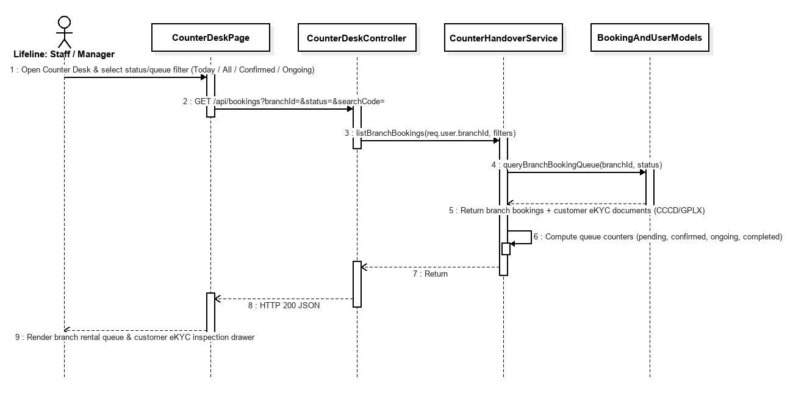

##### UC-27: Confirm Vehicle Handover (Check-in)
Staff completes the 5-point safety check (verify customer ID/license, photograph vehicle from 4 angles, record startOdometer and fuel level, confirm 2 helmets/2 raincoats/1 phone mount), collects 70% counter balance, and hands over the motorbike (BR-09, BR-10).

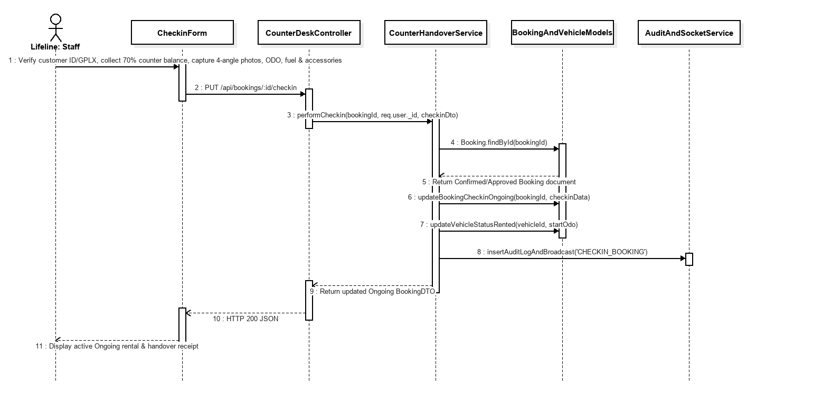

##### UC-28: Confirm Vehicle Return (Check-out)
Staff captures 4-angle return photos, compares vehicle condition with check-in, records return ODO and fuel level, settles late/damage fees, awards loyalty points, and completes the rental (BR-11, BR-12, BR-15).


##### UC-29: Record Incident & Settle Penalty Fees
Staff documents vehicle damage with photos, calculates late return fee (30,000 VND/hour rounded up per BR-11) and repair compensation, and records counter settlement.

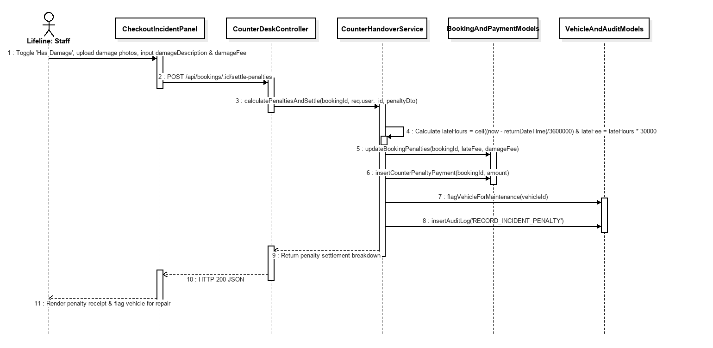

##### UC-30: Create Maintenance Ticket & Flag Vehicle
Staff updates vehicle status to Maintenance and logs a maintenance/repair ticket in MaintenanceLog.

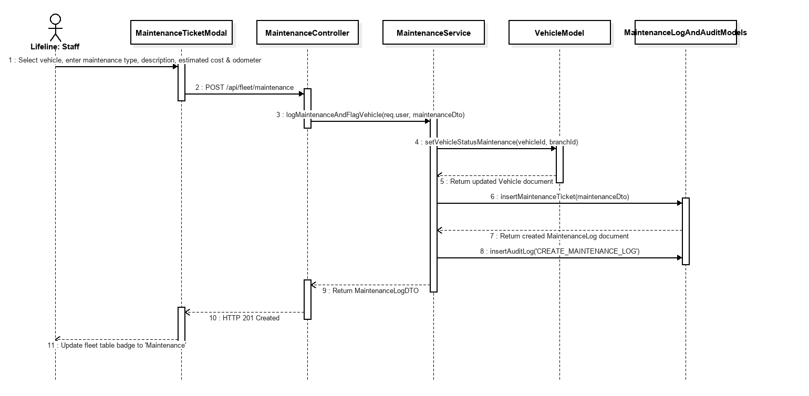

##### UC-31: Resolve Branch Customer Complaints
Staff investigates and responds to customer complaints assigned to their branch.

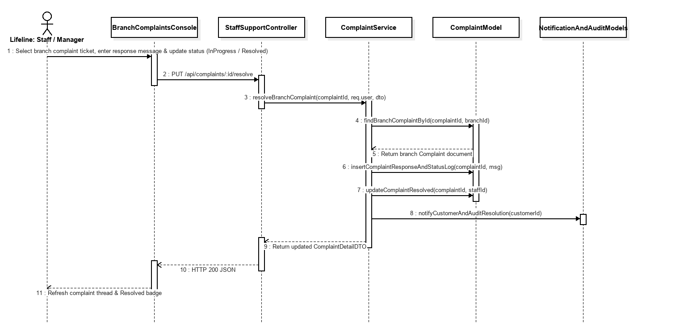

##### UC-32: Reply to Customer Support Chat
Staff responds to customer live chat messages in real time via the Staff Chat Console.

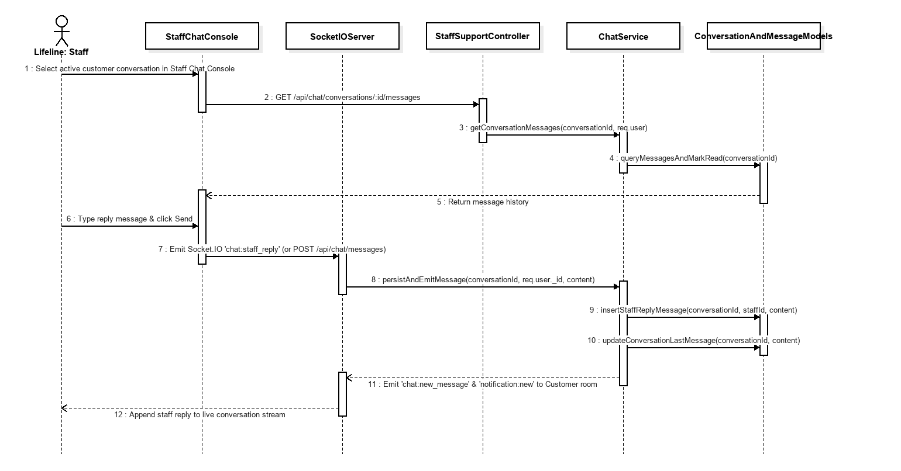

#### d. Database Queries

##### UC-26 — Inspect Branch Rental Queue
```typescript
// 1. Fetch branch rental queue populated with customer eKYC and vehicle info
const bookings = await Booking.find({
  $or: [{ pickupBranchId: branchId }, { returnBranchId: branchId }],
  ...(status && status !== 'all' ? { status } : {})
})
  .populate('userId', 'firstName lastName phoneNumber email identityStatus idCardNumber idCardFrontUrl idCardBackUrl drivingLicenseUrl')
  .populate('vehicleId', 'vehicleModel brand licensePlate odometer status images')
  .sort({ pickupDateTime: 1 })
  .lean();
```

##### UC-27 — Confirm Vehicle Handover (Check-in)
```typescript
// 1. Update Booking to Ongoing with 4-angle check-in photos, ODO, fuel, and 70% counter payment
const booking = await Booking.findByIdAndUpdate(
  bookingId,
  {
    $set: {
      status: 'Ongoing',
      startOdometer,
      startFuelLevel,
      checkinImages,
      existingDamageNotes,
      eSignatureUrl,
      isPaid: true,
      remainingAmount: 0,
      paidAmount: bookingDoc.totalAmount,
      approvedBy: req.user._id
    }
  },
  { new: true }
);

// 2. Update Vehicle status to Rented and sync odometer
await Vehicle.updateOne({ _id: booking.vehicleId }, { $set: { status: 'Rented', odometer: startOdometer } });
await AuditLog.create({ userId: req.user._id, action: 'CHECKIN_BOOKING', entity: 'Booking', entityId: bookingId, timestamp: new Date() });
```

##### UC-28 — Confirm Vehicle Return (Check-out)
```typescript
// 1. Complete Booking with return ODO, 4-angle checkout photos, lateFee, and damageFee
const completedBooking = await Booking.findByIdAndUpdate(
  bookingId,
  {
    $set: {
      status: 'Completed',
      actualReturnDateTime: new Date(),
      endOdometer,
      endFuelLevel,
      checkoutImages,
      lateFee,
      damageFee,
      settlementAmount: lateFee + damageFee,
      isPaid: true,
      remainingAmount: 0
    }
  },
  { new: true }
);

// 2. Award loyalty points (1 pt per 10,000 VND - BR-12) and update Vehicle status/ODO (BR-15)
const points = Math.floor((completedBooking.totalAmount - (completedBooking.discountAmount || 0)) / 10000);
await User.updateOne({ _id: completedBooking.userId }, { $inc: { loyaltyPoints: points } });
await Vehicle.updateOne(
  { _id: completedBooking.vehicleId },
  {
    $set: {
      status: hasDamage ? 'Maintenance' : 'Available',
      odometer: endOdometer,
      branchId: completedBooking.returnBranchId,
      requiresMaintenance: hasDamage || endOdometer >= vehicle.maintenanceODOThreshold
    }
  }
);
```

##### UC-29 — Record Incident & Settle Penalty Fees
```typescript
// 1. Record incident photos, damageFee, and lateFee (30,000 VND/hour rounded up - BR-11)
const lateHours = Math.max(0, Math.ceil((Date.now() - new Date(booking.returnDateTime).getTime()) / (3600 * 1000)));
const lateFee = lateHours * 30000;
await Booking.updateOne(
  { _id: bookingId },
  { $set: { lateFee, damageFee, damageNotes, damageImages, settlementAmount: lateFee + damageFee, isPaid: true } }
);

// 2. Record counter penalty payment and flag damaged vehicle for maintenance
await Payment.create({ bookingId, userId: booking.userId, amount: lateFee + damageFee, paymentMethod: 'Counter', paymentType: 'Penalty', status: 'Success' });
await Vehicle.updateOne({ _id: booking.vehicleId }, { $set: { status: 'Maintenance', requiresMaintenance: true } });
```

##### UC-30 — Create Maintenance Ticket & Flag Vehicle
```typescript
// 1. Transition Vehicle status to Maintenance
await Vehicle.findOneAndUpdate(
  { _id: vehicleId, branchId: req.user.branchId },
  { $set: { status: 'Maintenance', requiresMaintenance: true } }
);

// 2. Insert MaintenanceLog record and AuditLog entry
const log = await MaintenanceLog.create({
  vehicleId,
  branchId: req.user.branchId,
  performedBy: req.user._id,
  description,
  cost,
  odometerAtService,
  serviceDate: new Date(),
  status: 'InProgress'
});
await AuditLog.create({ userId: req.user._id, action: 'CREATE_MAINTENANCE_LOG', entity: 'MaintenanceLog', entityId: log._id.toString(), timestamp: new Date() });
```

##### UC-31 — Resolve Branch Customer Complaints
```typescript
// 1. Append staff response and status transition log
await ComplaintResponse.create({ complaintId, senderId: req.user._id, message: responseMessage });
await ComplaintStatusLog.create({ complaintId, fromStatus: complaint.status, toStatus: status, changedBy: req.user._id, note: resolutionNotes });

// 2. Update Complaint status to Resolved
await Complaint.findByIdAndUpdate(complaintId, {
  $set: { status: 'Resolved', resolutionNotes, resolvedBy: req.user._id, resolvedAt: new Date() }
});
```

##### UC-32 — Reply to Customer Support Chat
```typescript
// 1. Mark incoming customer messages as read
await Message.updateMany({ conversationId, senderId: { $ne: req.user._id }, isRead: false }, { $set: { isRead: true } });

// 2. Create staff reply Message and update Conversation preview
const reply = await Message.create({ conversationId, senderId: req.user._id, content, isRead: false });
await Conversation.findByIdAndUpdate(conversationId, { $set: { lastMessage: content, lastMessageAt: new Date(), assignedStaffId: req.user._id } });
```

---

### 8. Fleet & Staff Management Feature (UC-33 .. UC-42)

Empowers Branch Managers to administer their assigned branch (BR-14): adding new motorbikes with globally unique license plates (BR-13), updating or soft-deleting vehicles, configuring daily/hourly/seasonal rental pricing, approving or rejecting bookings, processing deposit refunds (BR-06), scheduling ODO-based maintenance (BR-15), coordinating inter-branch vehicle transfers with dual approval (BR-16), provisioning branch Staff accounts, assigning shift schedules and tracking attendance, and exporting branch analytics reports.

#### a. Class Diagram

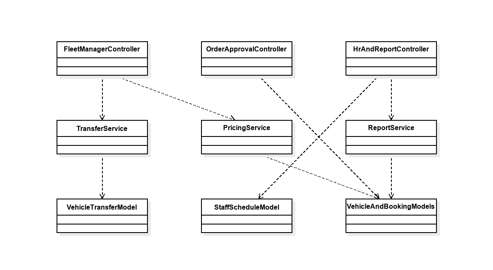

#### b. Class Specifications

##### FleetManagerController Class
Controller handling branch vehicle CRUD, pricing updates, and inter-branch transfer requests.

| No | Method | Description |
|---|---|---|
| 01 | `addVehicle(req, res, next)` | Inputs: AuthenticatedRequest (brand, vehicleModel, licensePlate, category, dailyPrice, maintenanceODOThreshold, images). Outputs: HTTP 201 JSON { data: vehicle }. Processing: Enforces BR-13 unique plate and BR-14 branch scope. |
| 02 | `updateOrDeleteVehicle(req, res, next)` | Inputs: req.params.id, req.body. Outputs: HTTP 200 JSON. Processing: Updates vehicle specs or soft-deletes (isDeleted=true) if no active bookings exist. |
| 03 | `configurePricing(req, res, next)` | Inputs: req.params.id, req.body (dailyPrice, hourlyPrice, seasonalRules). Outputs: HTTP 200 JSON. Processing: Updates pricing via PricingService. |
| 04 | `coordinateTransfer(req, res, next)` | Inputs: req.body / req.params.id. Outputs: HTTP 200/201 JSON. Processing: Creates or approves inter-branch VehicleTransfer (BR-16). |

##### OrderApprovalController Class
Controller managing branch booking approvals/rejections and deposit refund requests.

| No | Method | Description |
|---|---|---|
| 01 | `approveBooking(req, res, next)` | Inputs: req.params.id. Outputs: HTTP 200 JSON. Processing: Transitions Pending booking to Approved and notifies customer. |
| 02 | `rejectBooking(req, res, next)` | Inputs: req.params.id, req.body.rejectReason. Outputs: HTTP 200 JSON. Processing: Transitions booking to Cancelled with 100% refund eligibility. |
| 03 | `processRefundRequest(req, res, next)` | Inputs: req.params.id, req.body (decision, managerNote). Outputs: HTTP 200 JSON. Processing: Approves or rejects customer deposit refund request. |

##### HrAndReportController Class
Controller managing branch staff accounts, shift schedules, attendance, and branch revenue/utilization reports.

| No | Method | Description |
|---|---|---|
| 01 | `manageBranchStaff(req, res, next)` | Inputs: req.body (username, email, password, phoneNumber, status). Outputs: HTTP 200/201 JSON. Processing: Creates or updates Staff accounts assigned to manager's branchId (BR-14). |
| 02 | `assignShiftSchedule(req, res, next)` | Inputs: req.body (staffId, date, shiftType, notes). Outputs: HTTP 200 JSON. Processing: Upserts StaffSchedule entry and tracks clock-in/out attendance. |
| 03 | `exportBranchReport(req, res, next)` | Inputs: req.query (startDate, endDate, format). Outputs: JSON or Excel (.xlsx) stream. Processing: Aggregates revenue, utilization, and ratings via ReportService. |

##### TransferService Class
Service in server/src/modules/fleet/transferService.ts managing inter-branch motorbike relocations (BR-16).

| No | Method | Description |
|---|---|---|
| 01 | `createTransferRequest(user, dto)` | Inputs: managerUser, TransferRequestDTO. Outputs: Promise<IVehicleTransfer>. Processing: Creates VehicleTransfer with status='Pending'. |
| 02 | `approveAndRelocateVehicle(transferId, managerUser)` | Inputs: transferId, managerUser. Outputs: Promise<IVehicleTransfer>. Processing: Enforces dual-branch approval (BR-16), updates Vehicle.branchId = toBranchId, and sets transfer status='Completed'. |

##### PricingService Class
Service in server/src/modules/pricing/pricingService.ts managing base daily/hourly rates and seasonal pricing multipliers.

| No | Method | Description |
|---|---|---|
| 01 | `updateVehicleRates(vehicleId, dailyPrice, hourlyPrice)` | Inputs: vehicleId, dailyPrice, hourlyPrice. Outputs: Promise<IVehicle>. Processing: Validates positive rates and updates Vehicle document. |
| 02 | `upsertSeasonalRule(branchId, ruleDto)` | Inputs: branchId, SeasonalRuleDTO. Outputs: Promise<ISeasonalPricingRule>. Processing: Creates or updates holiday/weekend multiplier rule. |

##### ReportService Class
Analytics service in server/src/modules/report/reportService.ts computing branch KPIs and generating ExcelJS reports.

| No | Method | Description |
|---|---|---|
| 01 | `getBranchAnalytics(branchId, dateRange)` | Inputs: branchId, { startDate, endDate }. Outputs: Promise<BranchReportDTO>. Processing: Runs MongoDB aggregation pipelines on Booking, Vehicle, MaintenanceLog, and Feedback. |
| 02 | `generateExcelWorkbook(branchId, dateRange)` | Inputs: branchId, dateRange. Outputs: Promise<Buffer>. Processing: Builds multi-sheet ExcelJS workbook for branch revenue and fleet utilization. |

#### c. Sequence Diagram(s) — 1 Sequence Diagram per Use Case

##### UC-33: Add New Vehicle
Branch Manager registers a new motorbike (specs, globally unique license plate, ODO maintenance threshold, 4-angle photos, daily price) into their branch fleet (BR-13, BR-14).

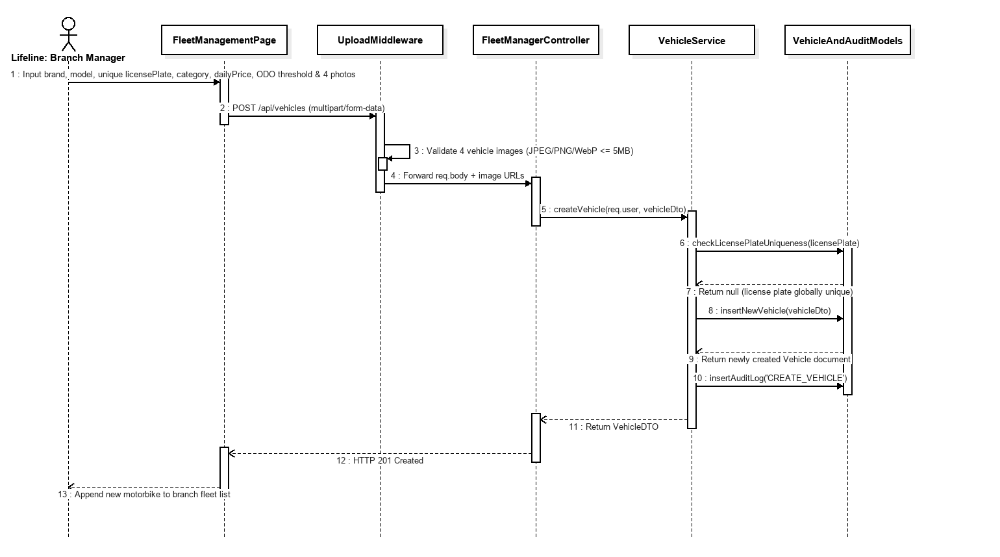

##### UC-34: Update & Decommission Vehicle
Branch Manager edits vehicle specifications/status or soft-deletes (isDeleted=true) a vehicle with no active bookings (BR-14).

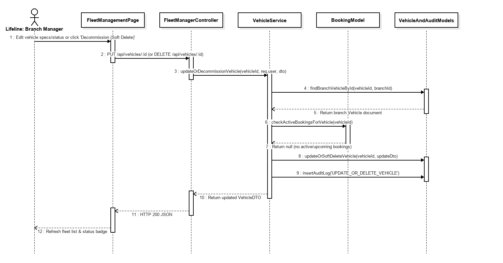

##### UC-35: Configure Vehicle Rental Pricing
Branch Manager sets and updates daily rental price, hourly rental rate, and peak season/holiday pricing rules.

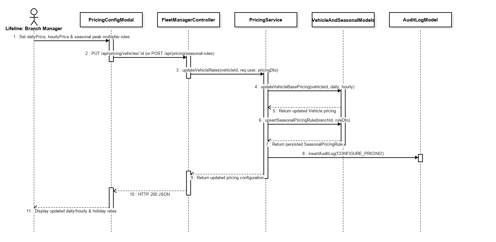

##### UC-36: Approve or Reject Rental Order
Branch Manager evaluates pending booking requests and approves or rejects them with a documented reason (triggering 100% deposit refund if rejected).


##### UC-37: Process Deposit Refund Requests
Branch Manager evaluates customer deposit refund requests and approves or rejects them according to the cancellation policy (BR-06).


##### UC-38: Schedule ODO Maintenance & Logs
Branch Manager schedules periodic ODO-based maintenance and audits full vehicle maintenance history (BR-15).


##### UC-39: Coordinate Inter-Branch Transfers
Branch Manager requests incoming vehicle transfers from other branches and approves outgoing transfers to relocate fleet inventory (BR-16).


##### UC-40: Provision & Update Staff Accounts
Branch Manager creates new Staff accounts, updates staff details, or deactivates staff within their assigned branch (BR-14, BR-FR05).


##### UC-41: Assign Work Shifts & Track Attendance
Branch Manager assigns shift schedule entries on the calendar and monitors staff clock-in/clock-out attendance.


##### UC-42: Generate & Export Branch Reports
Branch Manager resolves escalated complaints and generates daily/monthly/annual revenue, fleet utilization, breakdown frequency, and rating reports with Excel/PDF export.


#### d. Database Queries

##### UC-33 — Add New Vehicle
```typescript
// 1. Verify license plate is globally unique across all branches (BR-13)
const duplicate = await Vehicle.findOne({ licensePlate: licensePlate.trim().toUpperCase() }).lean();

// 2. Insert new Vehicle assigned to manager's branch (BR-14) and log audit trail
const vehicle = await Vehicle.create({
  branchId: req.user.branchId,
  category,
  vehicleModel,
  brand,
  licensePlate: licensePlate.trim().toUpperCase(),
  transmissionType,
  fuelType,
  dailyPrice,
  hourlyPrice,
  odometer,
  maintenanceODOThreshold: maintenanceODOThreshold || 1500,
  images,
  status: 'Available',
  isDeleted: false
});
await AuditLog.create({ userId: req.user._id, action: 'CREATE_VEHICLE', entity: 'Vehicle', entityId: vehicle._id.toString(), timestamp: new Date() });
```

##### UC-34 — Update & Decommission Vehicle
```typescript
// 1. Ensure vehicle has no active or upcoming bookings before decommissioning
const hasActiveBooking = await Booking.exists({
  vehicleId,
  status: { $in: ['Pending', 'Approved', 'Confirmed', 'Ongoing'] }
});

// 2. Soft-delete or update Vehicle within manager's branch
const updatedVehicle = await Vehicle.findOneAndUpdate(
  { _id: vehicleId, branchId: req.user.branchId, isDeleted: false },
  { $set: { ...updateDto, ...(isDecommission ? { isDeleted: true, status: 'Maintenance' } : {}) } },
  { new: true }
);
```

##### UC-35 — Configure Vehicle Rental Pricing
```typescript
// 1. Update base daily and hourly rates on Vehicle
const vehicle = await Vehicle.findOneAndUpdate(
  { _id: vehicleId, branchId: req.user.branchId },
  { $set: { dailyPrice: Number(dailyPrice), hourlyPrice: Number(hourlyPrice) } },
  { new: true }
);

// 2. Upsert seasonal/holiday pricing multiplier rule
const rule = await SeasonalPricingRule.findOneAndUpdate(
  { branchId: req.user.branchId, name: ruleName },
  { $set: { startDate, endDate, multiplier, isActive: true, createdBy: req.user._id } },
  { upsert: true, new: true }
);
```

##### UC-36 — Approve or Reject Rental Order
```typescript
// 1. Approve or Reject booking within manager's branch (BR-08, BR-14)
const updatedBooking = await Booking.findOneAndUpdate(
  { _id: bookingId, pickupBranchId: req.user.branchId, status: { $in: ['Pending', 'Confirmed'] } },
  {
    $set: {
      status: isApprove ? 'Approved' : 'Cancelled',
      approvedBy: req.user._id,
      ...(isApprove ? {} : { cancelReason: rejectReason, refundAmount: booking.paidAmount, refundStatus: booking.paidAmount > 0 ? 'Completed' : 'None' })
    }
  },
  { new: true }
);
```

##### UC-37 — Process Deposit Refund Requests
```typescript
// 1. Update refundStatus on Booking and log refund payment record
const booking = await Booking.findOneAndUpdate(
  { _id: bookingId, pickupBranchId: req.user.branchId, refundStatus: 'Requested' },
  {
    $set: {
      refundStatus: decision === 'Approve' ? 'Completed' : 'Rejected',
      refundNote: managerNote,
      refundedAt: new Date(),
      refundProcessedBy: req.user._id
    }
  },
  { new: true }
);
if (decision === 'Approve' && booking.refundAmount > 0) {
  await Payment.create({ bookingId: booking._id, userId: booking.userId, amount: -booking.refundAmount, paymentMethod: 'VNPay', paymentType: 'Refund', status: 'Success' });
}
```

##### UC-38 — Schedule ODO Maintenance & Logs
```typescript
// 1. Flag vehicles exceeding ODO maintenance interval (1,500 km - BR-15)
await Vehicle.updateMany(
  { branchId: req.user.branchId, isDeleted: false, $expr: { $gte: ['$odometer', '$maintenanceODOThreshold'] } },
  { $set: { requiresMaintenance: true } }
);

// 2. Complete scheduled maintenance and reset requiresMaintenance flag
await MaintenanceLog.findByIdAndUpdate(logId, { $set: { status: 'Completed', completedAt: new Date(), cost: actualCost } });
await Vehicle.findByIdAndUpdate(vehicleId, {
  $set: {
    status: 'Available',
    requiresMaintenance: false,
    lastMaintenanceBucket: Math.floor(currentOdo / 1500)
  }
});
```

##### UC-39 — Coordinate Inter-Branch Transfers
```typescript
// 1. Create inter-branch transfer request (BR-16)
const transfer = await VehicleTransfer.create({
  vehicleId,
  fromBranchId,
  toBranchId,
  requestedBy: req.user._id,
  reason,
  status: 'Pending'
});

// 2. Approve transfer and relocate Vehicle to destination branchId
const approvedTransfer = await VehicleTransfer.findByIdAndUpdate(
  transferId,
  { $set: { status: 'Completed', approvedBy: req.user._id, transferDate: new Date() } },
  { new: true }
);
await Vehicle.findByIdAndUpdate(approvedTransfer.vehicleId, {
  $set: { branchId: approvedTransfer.toBranchId, status: 'Available' }
});
```

##### UC-40 — Provision & Update Staff Accounts
```typescript
// 1. Create Staff account scoped to manager's branchId
const passwordHash = await bcrypt.hash(password, 10);
const staff = await User.create({
  username,
  email: email.toLowerCase(),
  firstName,
  lastName,
  phoneNumber,
  passwordHash,
  roles: 'Staff',
  branchId: req.user.branchId,
  status: 'Active',
  isEmailVerified: true,
  identityStatus: 'Verified'
});
await AuditLog.create({ userId: req.user._id, action: 'CREATE_STAFF', entity: 'User', entityId: staff._id.toString(), timestamp: new Date() });
```

##### UC-41 — Assign Work Shifts & Track Attendance
```typescript
// 1. Upsert staff shift assignment on calendar
const schedule = await StaffSchedule.findOneAndUpdate(
  { staffId, date: normalizedDate },
  {
    $set: {
      branchId: req.user.branchId,
      shiftType,
      assignedBy: req.user._id,
      notes
    }
  },
  { upsert: true, new: true }
);

// 2. Record staff clock-in / clock-out attendance timestamp
await StaffSchedule.findByIdAndUpdate(scheduleId, {
  $set: { checkInTime: new Date(), attendanceStatus: 'Present' }
});
```

##### UC-42 — Generate & Export Branch Reports
```typescript
// 1. Aggregate branch revenue and completed booking count by period
const revenueStats = await Booking.aggregate([
  { $match: { pickupBranchId: new mongoose.Types.ObjectId(branchId), status: 'Completed', createdAt: { $gte: startDate, $lte: endDate } } },
  { $group: { _id: { $dateToString: { format: '%Y-%m-%d', date: '$createdAt' } }, totalRevenue: { $sum: '$totalAmount' }, totalOrders: { $sum: 1 } } },
  { $sort: { _id: 1 } }
]);

// 2. Aggregate fleet utilization and maintenance breakdown frequency
const fleetStats = await Vehicle.aggregate([
  { $match: { branchId: new mongoose.Types.ObjectId(branchId), isDeleted: false } },
  { $group: { _id: '$status', count: { $sum: 1 } } }
]);
```

---

### 9. System Administration Feature (UC-43 .. UC-50)

Provides top-level System Administrators with chain-wide governance: adding, updating, and deactivating branches, provisioning Branch Manager accounts and RBAC permissions (BR-FR05), inspecting the system-wide AuditLog trail (BR-FR06), configuring vehicle categories and promotional discount vouchers, managing global policies (deposit %, cancellation rules, loyalty rate, multi-language locale), publishing homepage banners and static CMS pages, and analyzing chain KPIs with VNPay financial reconciliation and VAT tax exports.

#### a. Class Diagram


#### b. Class Specifications

##### AdminBranchAccountController Class
Controller managing chain-wide Branch CRUD, Branch Manager account provisioning, RBAC configuration, and AuditLog queries.

| No | Method | Description |
|---|---|---|
| 01 | `createBranch(req, res, next)` | Inputs: req.body (name, code, address, phone, email, latitude, longitude, openingHours, managerId). Outputs: HTTP 201 JSON { data: branch }. Processing: Creates Branch and links 1:1 BranchManager. |
| 02 | `updateDeactivateBranch(req, res, next)` | Inputs: req.params.id, req.body. Outputs: HTTP 200 JSON. Processing: Updates branch metadata or toggles isActive=false. |
| 03 | `provisionManagerAccount(req, res, next)` | Inputs: req.body (username, email, roles, branchId, status). Outputs: HTTP 200/201 JSON. Processing: Creates/updates Manager account or locks/unlocks violating user. |
| 04 | `getAuditLogs(req, res, next)` | Inputs: req.query (action, entity, userId, startDate, endDate, page, limit). Outputs: HTTP 200 JSON { data: AuditLog[], pagination }. Processing: Queries system-wide AuditLog restricted to SystemAdmin. |

##### CatalogAndConfigController Class
Controller managing vehicle Categories, Discount vouchers, and SystemConfig policies/locale.

| No | Method | Description |
|---|---|---|
| 01 | `manageCategories(req, res, next)` | Inputs: req.body (name, slug, description, defaultDailyRate, isActive). Outputs: HTTP 200/201 JSON. Processing: Creates, updates, or deactivates vehicle Category. |
| 02 | `manageDiscounts(req, res, next)` | Inputs: req.body (code, discountPercent, maxDiscountAmount, minOrderValue, startDate, endDate, usageLimit). Outputs: HTTP 200/201 JSON. Processing: Manages promotional voucher codes. |
| 03 | `updateSystemConfig(req, res, next)` | Inputs: req.body (depositPercent, cancellationFreeHours, lateFeePerHour, loyaltyVndPerPoint, i18n). Outputs: HTTP 200 JSON. Processing: Updates global SystemConfig document. |

##### CmsAndFinanceController Class
Controller managing homepage promotional Banners, StaticPages, chain-wide KPI dashboards, and VNPay financial/tax reconciliation.

| No | Method | Description |
|---|---|---|
| 01 | `manageBannersAndPages(req, res, next)` | Inputs: BannerDTO / StaticPageDTO. Outputs: HTTP 200/201 JSON. Processing: Creates, updates, or deletes Banner and sanitized StaticPage entries. |
| 02 | `getChainKpiDashboard(req, res, next)` | Inputs: req.query (startDate, endDate). Outputs: HTTP 200 JSON. Processing: Computes chain-wide revenue trends, branch comparisons, and seasonal demand forecasts. |
| 03 | `reconcileFinanceAndTax(req, res, next)` | Inputs: req.query (month, year). Outputs: HTTP 200 JSON / Excel tax report. Processing: Cross-checks VNPay Payment records against Booking totals and computes 10% VAT. |

##### AdminService Class
Service in server/src/modules/admin/adminService.ts handling manager account provisioning, account lock/unlock, and audit log filtering.

| No | Method | Description |
|---|---|---|
| 01 | `createOrUpdateManager(adminUser, dto)` | Inputs: adminUser, ManagerAccountDTO. Outputs: Promise<IUser>. Processing: Creates/updates User with roles='BranchManager', links Branch.managerId, and records AuditLog. |
| 02 | `queryAuditTrail(filters, pagination)` | Inputs: AuditFilterDTO, PaginationDTO. Outputs: Promise<PaginatedAuditLogs>. Processing: Executes indexed query on AuditLog populated with userId. |

##### FinanceService Class
Service in server/src/modules/finance/financeService.ts computing chain-wide financial KPIs, VNPay settlement reconciliation, and tax reports.

| No | Method | Description |
|---|---|---|
| 01 | `computeChainKpis(dateRange)` | Inputs: { startDate, endDate }. Outputs: Promise<ChainKpiDTO>. Processing: Aggregates revenue, booking volume, fleet utilization, and branch rankings across all branches. |
| 02 | `reconcileVnPayTransactions(month, year)` | Inputs: month, year. Outputs: Promise<ReconcileReportDTO>. Processing: Matches Payment(paymentMethod='VNPay') with Booking.paidAmount and calculates 10% VAT liability. |

#### c. Sequence Diagram(s) — 1 Sequence Diagram per Use Case

##### UC-43: Add New Branch
System Admin creates a new branch with name, unique code, address, GPS coordinates, operating hours, and assigned Branch Manager.


##### UC-44: Update & Deactivate Branch
System Admin updates branch details, reassigns managers, or deactivates a branch (isActive=false).


##### UC-45: Provision Manager Accounts & RBAC
System Admin creates/updates/deactivates Branch Manager accounts, configures RBAC permissions, and locks/unlocks violating accounts (BR-FR05, BR-FR06).


##### UC-46: Inspect System Audit Logs
System Admin searches, filters, and audits the system-wide security and CRUD activity trail in AuditLog (BR-FR06).


##### UC-47: Configure Vehicle Categories & Promos
System Admin creates, updates, and deactivates vehicle categories (Scooter, Manual, Semi-Auto, Electric) and promotional discount voucher codes.


##### UC-48: Configure System Policies & Locale
System Admin configures cancellation/refund rules, default deposit %, loyalty program rules, and multi-language settings.


##### UC-49: Publish Promotional Banners & Pages
System Admin creates, updates, and deletes homepage promotional banners and static pages (FAQ, Terms of Service, Privacy Policy).


##### UC-50: Analyze Chain KPIs & Reconcile Finance
System Admin analyzes chain-wide revenue KPIs, branch comparisons, and seasonal demand forecasts; reconciles VNPay payments and exports tax reports.


#### d. Database Queries

##### UC-43 — Add New Branch
```typescript
// 1. Verify branch code uniqueness and create Branch
const existing = await Branch.findOne({ code: code.trim().toUpperCase() }).lean();
const branch = await Branch.create({
  name,
  code: code.trim().toUpperCase(),
  address,
  phone,
  email,
  latitude,
  longitude,
  openingHours,
  managerId: managerId || null,
  isActive: true
});

// 2. Bind assigned Branch Manager (1:1 relationship) and write AuditLog
if (managerId) {
  await User.findByIdAndUpdate(managerId, { $set: { branchId: branch._id, roles: 'BranchManager' } });
}
await AuditLog.create({ userId: req.user._id, action: 'CREATE_BRANCH', entity: 'Branch', entityId: branch._id.toString(), timestamp: new Date() });
```

##### UC-44 — Update & Deactivate Branch
```typescript
// 1. Update Branch metadata or deactivate (isActive = false)
const updatedBranch = await Branch.findByIdAndUpdate(
  branchId,
  { $set: { name, address, phone, email, latitude, longitude, openingHours, managerId, isActive } },
  { new: true, runValidators: true }
);
await AuditLog.create({ userId: req.user._id, action: 'UPDATE_BRANCH', entity: 'Branch', entityId: branchId, timestamp: new Date() });
```

##### UC-45 — Provision Manager Accounts & RBAC
```typescript
// 1. Provision or update BranchManager account and link to Branch
const manager = await User.findOneAndUpdate(
  { email: email.toLowerCase() },
  { $set: { username, firstName, lastName, phoneNumber, roles: 'BranchManager', branchId, status, isEmailVerified: true } },
  { upsert: true, new: true }
);
await Branch.findByIdAndUpdate(branchId, { $set: { managerId: manager._id } });

// 2. Lock or unlock violating user account
await User.findByIdAndUpdate(targetUserId, {
  $set: { status: isLock ? 'Locked' : 'Active', lockUntil: isLock ? new Date(Date.now() + 365 * 24 * 3600 * 1000) : null }
});
await AuditLog.create({ userId: req.user._id, action: isLock ? 'LOCK_ACCOUNT' : 'UNLOCK_ACCOUNT', entity: 'User', entityId: targetUserId, timestamp: new Date() });
```

##### UC-46 — Inspect System Audit Logs
```typescript
// 1. Query filtered and paginated system audit trail
const filter = {
  ...(action ? { action } : {}),
  ...(entity ? { entity } : {}),
  ...(userId ? { userId: new mongoose.Types.ObjectId(userId) } : {}),
  ...(startDate || endDate ? { timestamp: { ...(startDate ? { $gte: new Date(startDate) } : {}), ...(endDate ? { $lte: new Date(endDate) } : {}) } } : {})
};
const [logs, total] = await Promise.all([
  AuditLog.find(filter).populate('userId', 'username email firstName lastName roles').sort({ timestamp: -1 }).skip(skip).limit(limit).lean(),
  AuditLog.countDocuments(filter)
]);
```

##### UC-47 — Configure Vehicle Categories & Promos
```typescript
// 1. Create or update vehicle Category
const category = await Category.findOneAndUpdate(
  { slug },
  { $set: { name, slug, description, iconSvg, isActive } },
  { upsert: true, new: true }
);

// 2. Create or update promotional Discount voucher
const discount = await Discount.create({
  code: code.trim().toUpperCase(),
  description,
  discountPercent,
  discountAmount,
  maxDiscountAmount,
  minOrderValue,
  startDate,
  endDate,
  usageLimit,
  isActive: true
});
await AuditLog.create({ userId: req.user._id, action: 'CREATE_DISCOUNT', entity: 'Discount', entityId: discount._id.toString(), timestamp: new Date() });
```

##### UC-48 — Configure System Policies & Locale
```typescript
// 1. Upsert global policy configuration in SystemConfig
const config = await SystemConfig.findOneAndUpdate(
  { key: 'GLOBAL_SYSTEM_POLICY' },
  {
    $set: {
      value: {
        depositPercent: 30,
        oneWaySurchargeVnd: 50000,
        lateFeePerHourVnd: 30000,
        freeCancelHoursBeforePickup: 24,
        loyaltyVndPerPoint: 10000,
        maintenanceOdoIntervalKm: 1500,
        supportedLocales: ['vi', 'en']
      },
      updatedBy: req.user._id
    }
  },
  { upsert: true, new: true }
);
await AuditLog.create({ userId: req.user._id, action: 'UPDATE_SYSTEM_CONFIG', entity: 'SystemConfig', entityId: config._id.toString(), timestamp: new Date() });
```

##### UC-49 — Publish Promotional Banners & Pages
```typescript
// 1. Create or update homepage promotional Banner
const banner = await Banner.create({
  title,
  subtitle,
  imageUrl,
  linkUrl,
  displayOrder,
  isActive: true
});

// 2. Update CMS StaticPage with sanitized HTML content
const page = await StaticPage.findByIdAndUpdate(
  pageId,
  { $set: { title: title.trim(), content: sanitizePageContent(content), type, isPublished: Boolean(isPublished), updatedBy: req.user._id } },
  { new: true }
);
await AuditLog.create({ userId: req.user._id, action: 'UPDATE_STATIC_PAGE', entity: 'StaticPage', entityId: pageId, timestamp: new Date() });
```

##### UC-50 — Analyze Chain KPIs & Reconcile Finance
```typescript
// 1. Chain-wide revenue KPI and branch comparison aggregation
const branchComparison = await Booking.aggregate([
  { $match: { status: 'Completed', createdAt: { $gte: startDate, $lte: endDate } } },
  {
    $group: {
      _id: '$pickupBranchId',
      grossRevenue: { $sum: '$totalAmount' },
      netRevenue: { $sum: { $subtract: ['$totalAmount', { $ifNull: ['$discountAmount', 0] }] } },
      vatLiability: { $sum: { $multiply: ['$totalAmount', 0.1] } },
      completedOrders: { $sum: 1 }
    }
  },
  { $lookup: { from: 'branches', localField: '_id', foreignField: '_id', as: 'branch' } },
  { $unwind: '$branch' },
  { $sort: { grossRevenue: -1 } }
]);

// 2. Reconcile VNPay IPN Payment records against Booking paidAmount
const vnpayPayments = await Payment.find({
  paymentMethod: 'VNPay',
  status: 'Success',
  createdAt: { $gte: startDate, $lte: endDate }
}).populate('bookingId', 'bookingCode totalAmount depositAmount paidAmount status').lean();
```

---

