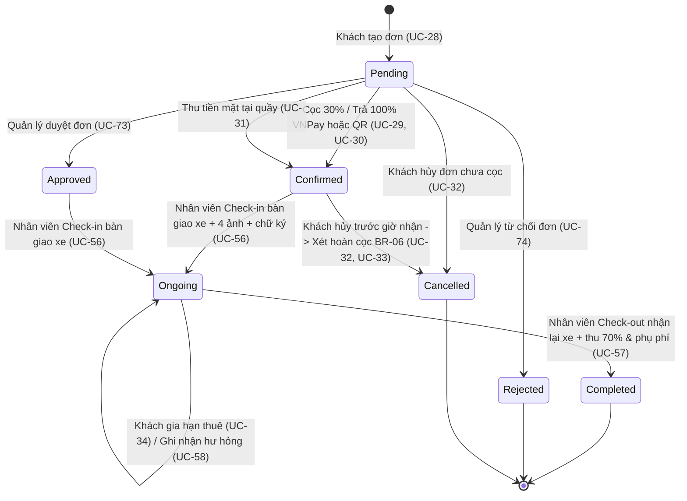
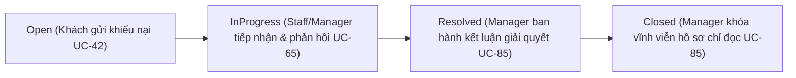
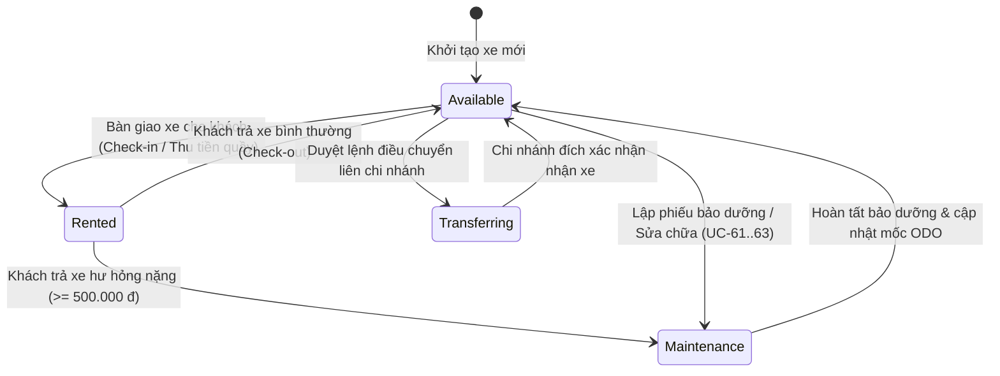

# TÀI LIỆU TỔNG HỢP TOÀN BỘ LUỒNG NGHIỆP VỤ HỆ THỐNG MOTORENT

**Dự án:** Hệ thống Quản lý & Cho thuê Xe máy Đa Chi nhánh Đà Nẵng (MOTORENT)  
**Kiến trúc:** Modular Monolith / Clean Architecture (`Node.js + Express + TypeScript + MongoDB + Socket.IO` & `React + Vite + Tailwind CSS`)  
**Cập nhật:** 28/10/2026

---

## MỤC LỤC

1. [Tổng quan Môi trường, Chi nhánh & Tài khoản Kiểm thử](#1-tổng-quan-môi-trường-chi-nhánh--tài-khoản-kiểm-thử)
2. [Sơ đồ Vòng đời Trạng thái Trung tâm (State & Sequence Flows)](#2-sơ-đồ-vòng-đời-trạng-thái-trung-tâm-state--sequence-flows)
3. [Chi tiết 10 Nhóm Luồng Nghiệp vụ Đầu-Cuối (End-to-End)](#3-chi-tiết-10-nhóm-luồng-nghiệp-vụ-đầu-cuối-end-to-end)
   - [Luồng 01: Khách vãng lai — Tra cứu Chi nhánh GPS, Đội xe & Trang tĩnh](#luồng-01-khách-vãng-lai--tra-cứu-chi-nhánh-gps-đội-xe--trang-tĩnh)
   - [Luồng 02: Xác thực Tài khoản, Bảo mật Phiên & Định danh eKYC](#luồng-02-xác-thực-tài-khoản-bảo-mật-phiên--định-danh-ekyc)
   - [Luồng 03: Đặt xe, Báo giá động, Khuyến mãi & Thanh toán VNPay / QR](#luồng-03-đặt-xe-báo-giá-động-khuyến-mãi--thanh-toán-vnpay--qr)
   - [Luồng 04: Quản lý Chuyến xe Khách hàng — Gia hạn, Hủy đơn, Hoàn cọc & Hóa đơn PDF](#luồng-04-quản-lý-chuyến-xe-khách-hàng--gia-hạn-hủy-đơn-hoàn-cọc--hóa-đơn-pdf)
   - [Luồng 05: Vận hành Quầy Giao dịch — Thu tiền, Check-in Bàn giao & Check-out Tất toán](#luồng-05-vận-hành-quầy-giao-dịch--thu-tiền-check-in-bàn-giao--check-out-tất-toán)
   - [Luồng 06: Hậu mãi & Chăm sóc Khách hàng — Đánh giá, Khiếu nại 4 Cấp & Live Chat](#luồng-06-hậu-mãi--chăm-sóc-khách-hàng--đánh-giá-khiếu-nại-4-cấp--live-chat)
   - [Luồng 07: Quản trị Đội xe, Bảng giá Linh hoạt, Điều chuyển Trạm & Bảo dưỡng ODO](#luồng-07-quản-trị-đội-xe-bảng-giá-linh-hoạt-điều-chuyển-trạm--bảo-dưỡng-odo)
   - [Luồng 08: Quản trị Nhân sự (HR) — Hồ sơ Nhân viên, Phân ca trực & Chấm công](#luồng-08-quản-trị-nhân-sự-hr--hồ-sơ-nhân-viên-phân-ca-trực--chấm-công)
   - [Luồng 09: Báo cáo Doanh thu, Đối soát Tài chính VNPay, Thuế GTGT & Dự báo Nhu cầu](#luồng-09-báo-cáo-doanh-thu-đối-soát-tài-chính-vnpay-thuế-gtgt--dự-báo-nhu-cầu)
   - [Luồng 10: Quản trị Hệ thống Cấp cao, CMS, Đa ngôn ngữ, Kiểm toán & RBAC](#luồng-10-quản-trị-hệ-thống-cấp-cao-cms-đa-ngôn-ngữ-kiểm-toán--rbac)
4. [Bảng Tra cứu Nhanh Đường dẫn Giao diện theo Vai trò](#4-bảng-tra-cứu-nhanh-đường-dẫn-giao-diện-theo-vai-trò)
5. [Danh mục Dữ liệu Cơ sở (MongoDB Collections)](#5-danh-mục-dữ-liệu-cơ-sở-mongodb-collections)

---

## 1. Tổng quan Môi trường, Chi nhánh & Tài khoản Kiểm thử

### 1.1. Cổng dịch vụ
| Thành phần | Địa chỉ chạy cục bộ | Thư mục nguồn |
| :--- | :--- | :--- |
| **Frontend (React + Vite)** | `http://localhost:5173` | `client/src/` |
| **Backend API & Socket.IO** | `http://localhost:5000/api` | `server/src/` |
| **MongoDB chính** | `mongodb://127.0.0.1:27017/motorent_db` | Tách biệt hoàn toàn với `motorent_test` khi chạy Vitest |

### 1.2. Hai chi nhánh chính thức tại Đà Nẵng
| Mã trạm | Tên chi nhánh | Địa chỉ | Giờ hoạt động |
| :--- | :--- | :--- | :--- |
| **`CN-DAD`** | Chi nhánh Sân Bay Quốc Tế Đà Nẵng (Hải Châu) | Cổng Ga Quốc Tế, Đường Duy Tân, Q. Hải Châu | `06:00 - 23:00` |
| **`CN-MK`** | Chi nhánh Bãi Biển Mỹ Khê | 28 Võ Nguyên Giáp, P. Phước Mỹ, Q. Sơn Trà | `07:00 - 22:30` |

### 1.3. Tài khoản mẫu theo 4 vai trò RBAC
| Vai trò (`roles`) | Tài khoản (`username` / `email`) | Mật khẩu mặc định | Chi nhánh gán |
| :--- | :--- | :--- | :--- |
| **`SystemAdmin`** | `admin` / `admin@motorent.vn` | `Admin@123456` | Toàn hệ thống |
| **`BranchManager`** | `manager_dad` / `manager.dad@motorent.vn` | `Manager@123456` | `CN-DAD` (Sân Bay) |
| **`BranchManager`** | `manager_mk` / `manager.mk@motorent.vn` | `Manager@123456` | `CN-MK` (Mỹ Khê) |
| **`Staff`** | `staff_dad` / `staff.dad@motorent.vn` | `Staff@123456` | `CN-DAD` (Sân Bay) |
| **`Staff`** | `staff_mk` / `staff.mk@motorent.vn` | `Staff@123456` | `CN-MK` (Mỹ Khê) |
| **`Customer`** | `customer_hoang` / `hoang.nguyen@gmail.com` (hoặc Google OAuth) | `Customer@123456` | Không giới hạn |

---

## 2. Sơ đồ Vòng đời Trạng thái Trung tâm (State & Sequence Flows)

### 2.1. Vòng đời Đơn thuê xe & Dòng tiền (`Booking` + `Payment`)

### 2.2. Vòng đời Xử lý Khiếu nại 4 Cấp (`Complaint`)

### 2.3. Vòng đời Trạng thái Phương tiện (`Vehicle`)

---

## 3. Chi tiết 10 Nhóm Luồng Nghiệp vụ Đầu-Cuối (End-to-End)

---

### Luồng 01: Khách vãng lai — Tra cứu Chi nhánh GPS, Đội xe & Trang tĩnh
- **Actor:** `Guest` / `Customer`
- **Use Cases:** `UC-01`, `UC-02`, `UC-03..UC-14`, `UC-27`, `UC-119`
- **Giao diện Frontend:**
  - `/` (`HomePage.tsx`) — Banner động CMS, tìm kiếm nhanh theo ngày nhận/trả, danh mục xe nổi bật.
  - `/branches` (`BranchesPage.tsx`) — Danh sách chi nhánh kèm bản đồ tương tác Leaflet (`BranchInteractiveMap.tsx`).
  - `/bikes` (`FleetPage.tsx`) & `/bikes/:vehicleId` (`VehicleDetailPage.tsx`) — Bộ lọc đa tiêu chí & chi tiết xe.
  - `/rental-policy`, `/faq`, `/terms`, `/privacy`, `/pages/:slug` (`RentalPolicyPage.tsx`, `StaticPageView.tsx`).
- **API Backend chính:**
  - `GET /api/branches`, `GET /api/branches/nearby?lat=...&lng=...`
  - `GET /api/categories`, `GET /api/vehicles`, `GET /api/vehicles/:id`, `GET /api/reviews/vehicle/:vehicleId`
  - `GET /api/banners`, `GET /api/pages/:slug`
- **Trình tự xử lý chính:**
  1. Khách cấp quyền định vị trình duyệt -> hệ thống tính khoảng cách Haversine tới `CN-DAD` và `CN-MK`, sắp xếp trạm gần nhất kèm số xe `Available` thực tế.
  2. Khách lọc xe theo khung giờ `pickupDateTime` – `returnDateTime` -> Backend loại trừ các xe đang kẹt đơn chồng lấn lịch, chỉ hiển thị xe thực sự còn trống.
  3. Tại trang chi tiết xe, khách xem ảnh thực tế, thông số ODO, giá theo giờ/ngày/cuối tuần và toàn bộ đánh giá có xác thực chuyến đi.

---

### Luồng 02: Xác thực Tài khoản, Bảo mật Phiên & Định danh eKYC
- **Actor:** `Guest` -> `Customer` -> `Staff` / `BranchManager` (duyệt eKYC)
- **Use Cases:** `UC-15..UC-26`
- **Giao diện Frontend:**
  - `/register`, `/verify-email`, `/login`, `/forgot-password`, `/reset-password`
  - `/profile` (`ProfilePage.tsx` — các tab: `bookings`, `info`, `avatar`, `ekyc`, `password`)
  - `/wishlist` (`WishlistPage.tsx`)
  - `/counter?mode=ekyc` (`CounterDesk.tsx` — phía Nhân viên duyệt)
- **API Backend chính:**
  - `POST /api/auth/register`, `GET /api/auth/verify-email/:token`, `POST /api/auth/login`, `POST /api/auth/logout`
  - `GET /api/auth/google`, `GET /api/auth/google/callback`
  - `POST /api/auth/forgot-password`, `POST /api/auth/reset-password`
  - `GET /api/auth/me`, `PUT /api/auth/me`, `PUT /api/auth/me/avatar`, `PUT /api/auth/change-password`
  - `POST /api/auth/ekyc`, `GET /api/auth/ekyc/pending`, `PUT /api/auth/ekyc/:userId/review`
  - `GET /api/wishlist`, `POST /api/wishlist/:vehicleId`, `DELETE /api/wishlist/:vehicleId`
- **Trình tự & Quy tắc bảo mật:**
  1. **Đăng ký & Email Verification:** Băm mật khẩu `bcrypt (10 rounds)`, gửi mã xác thực 24h qua SMTP.
  2. **Đăng nhập & Chống vét cạn:** Sai mật khẩu liên tiếp 6 lần sẽ tự động khóa đăng nhập tài khoản trong 30 phút (`lockUntil`) và ghi `AuditLog`. Hỗ trợ đăng nhập/tự gộp tài khoản qua **Google OAuth 2.0**.
  3. **Định danh điện tử eKYC (`UC-22`):**
     - Khách tải lên CCCD mặt trước, CCCD mặt sau, Bằng lái xe và ảnh Selfie tại `/profile?tab=ekyc` (ảnh được nén & chèn watermark chống sử dụng trái phép).
     - Hồ sơ chuyển sang `identityStatus: Pending` và đẩy thông báo tới quầy.
     - Nhân viên mở `/counter?mode=ekyc`, phóng to/xoay kiểm tra giấy tờ -> bấm **Phê duyệt (`Verified`)** hoặc **Từ chối (`Rejected`)** kèm ghi chú lý do.

---

### Luồng 03: Đặt xe, Báo giá động, Khuyến mãi & Thanh toán VNPay / QR
- **Actor:** `Customer`
- **Use Cases:** `UC-28`, `UC-29`, `UC-30`
- **Giao diện Frontend:**
  - `/booking/:vehicleId` (`BookingPage.tsx`)
  - `/vnpay-return` (`VnPayReturnPage.tsx`)
  - Modal thanh toán lại QR/VNPay tại `/profile?tab=bookings`
- **API Backend chính:**
  - `POST /api/bookings/quote` (tính giá nháp & kiểm tra lịch trống)
  - `POST /api/discounts/validate` (kiểm tra mã giảm giá)
  - `POST /api/bookings` (khởi tạo đơn `MV-XXXXXX`)
  - `POST /api/payments/create-vnpay-url`, `GET /api/payments/vnpay-return`, `GET /api/payments/vnpay-ipn`
  - `POST /api/payments/verify-qr/:bookingId`
- **Trình tự & Quy tắc nghiệp vụ:**
  1. **Kiểm tra điều kiện đặt xe:** Thời lượng thuê tối thiểu `2 giờ`, tối đa `30 ngày`; giờ nhận và giờ trả phải nằm trong khung giờ mở cửa của chi nhánh nhận (`pickupBranchId`) và chi nhánh trả (`returnBranchId`).
  2. **Chống trùng lịch nguyên tử (`BR-02`):** Kiểm tra toàn bộ các đơn `Pending/Approved/Confirmed/Ongoing` của xe đó để ngăn đặt trùng khung giờ.
  3. **Định giá linh hoạt & Khuyến mãi:** Áp dụng công thức tính giờ/ngày + quy tắc giá mùa cao điểm/cuối tuần (`SeasonalPricingRule`) -> trừ mã giảm giá (`Discount`) -> tách rõ **Cọc 30% (`depositAmount`)** và **Còn lại 70% (`remainingAmount`)**.
  4. **Thanh toán Online:**
     - Khách chọn đặt cọc `30%` hoặc thanh toán đủ `100%` qua cổng **VNPay Sandbox** (hoặc xác thực chuyển khoản QR).
     - Khi giao dịch thành công: tạo bản ghi `Payment` (`type: 'DEPOSIT'` hoặc `'FULL'`, `status: 'SUCCESS'`), chuyển đơn sang `Confirmed`, gửi Email xác nhận và bắn sự kiện Socket.IO cập nhật tức thì trên cả màn hình Khách hàng lẫn Quầy nhân viên.

---

### Luồng 04: Quản lý Chuyến xe Khách hàng — Gia hạn, Hủy đơn, Hoàn cọc & Hóa đơn PDF
- **Actor:** `Customer` (phối hợp `BranchManager` duyệt hoàn cọc)
- **Use Cases:** `UC-32`, `UC-33`, `UC-34`, `UC-35`, `UC-36`, `UC-37`, `UC-38`
- **Giao diện Frontend:**
  - `/profile?tab=bookings` (`ProfilePage.tsx`)
  - `/booking-details/:id` (`OrderDetailPage.tsx`)
- **API Backend chính:**
  - `GET /api/bookings/me`, `GET /api/bookings/:id`
  - `POST /api/bookings/:id/extend/estimate`, `PUT /api/bookings/:id/extend`
  - `PUT /api/bookings/:id/cancel`, `POST /api/bookings/:id/refund-request`
  - `GET /api/bookings/:id/invoice`
- **Trình tự xử lý:**
  1. **Gia hạn chuyến đi (`UC-34`):** Khi đơn đang hiệu lực, khách chọn ngày trả mới -> hệ thống kiểm tra không đụng lịch đơn kế tiếp -> cộng thêm phí thuê phát sinh vào `remainingAmount`.
  2. **Hủy đơn theo chính sách `BR-06` (`UC-32`):**
     - Hủy cách giờ nhận xe **`> 24 giờ`**: Miễn phí hủy, hoàn `100%` số tiền khách đã đóng.
     - Hủy trong vòng **`<= 24 giờ`** trước giờ nhận: Khấu trừ `50%` tiền cọc, hoàn phần dư còn lại.
     - Đơn đã nhận xe (`Ongoing` / `Completed`): Không cho phép hủy.
     - Tự động giải phóng xe về `Available` và hoàn lại lượt dùng mã giảm giá (`Discount.usedCount`).
  3. **Gửi STK nhận hoàn cọc (`UC-33`):** Khách nhập Ngân hàng, Số tài khoản, Chủ tài khoản -> tạo/cập nhật bản ghi `Payment` (`type: 'REFUND'`, `status: 'PENDING'`) đẩy lên quầy Quản lý xét duyệt.
  4. **Xuất Hóa đơn điện tử PDF (`UC-38`):** Tải file `MOTORENT-INVOICE-MV-XXXXXX.pdf` sinh trực tiếp từ dữ liệu đơn thực tế.

---

### Luồng 05: Vận hành Quầy Giao dịch — Thu tiền, Check-in Bàn giao & Check-out Tất toán
- **Actor:** `Staff`, `BranchManager`, `SystemAdmin`
- **Use Cases:** `UC-31`, `UC-54`, `UC-56`, `UC-57`, `UC-58`, `UC-59`, `UC-73..UC-76`
- **Giao diện Frontend:** `/counter` (`CounterDesk.tsx` — Tab `01. Đơn thuê & Bàn giao`)
- **API Backend chính:**
  - `GET /api/bookings/branch` (hàng đợi đơn theo chi nhánh gán cho nhân sự)
  - `POST /api/bookings/:id/counter-payment` (`UC-31`)
  - `PUT /api/bookings/:id/approve` (`UC-73`), `PUT /api/bookings/:id/reject` (`UC-74`)
  - `PUT /api/bookings/:id/refund/approve` (`UC-75`), `PUT /api/bookings/:id/refund/reject` (`UC-76`)
  - `PUT /api/bookings/:id/checkin` (`UC-56`)
  - `POST /api/bookings/:id/damage` (`UC-58`), `GET /api/bookings/:id/penalty-preview` (`UC-59`)
  - `PUT /api/bookings/:id/checkout` (`UC-57`)
- **Trình tự vận hành chuẩn tại quầy:**
  1. **Cô lập theo chi nhánh:** Nhân viên `staff_dad` chỉ thấy đơn có trạm nhận hoặc trạm trả thuộc `CN-DAD`; `staff_mk` chỉ thấy đơn thuộc `CN-MK`; `admin` thấy toàn chuỗi.
  2. **Thu tiền tại quầy (`UC-31`):** Nếu khách đặt giữ chỗ hoặc muốn đóng trước phần còn lại tại quầy, nhân viên bấm thu tiền -> ghi sổ `Payment` (`type: 'COUNTER'`, `status: 'SUCCESS'`).
  3. **Bàn giao xe Check-in (`UC-56`):**
     - Hệ thống **tự động điền ODO hiện tại của xe** vào ô ODO xuất bến (không cần nhập lại số CCCD thủ công).
     - Kiểm tra 7 mục an toàn (Giấy tờ, GPLX, Lốp, Phanh, Đèn, Xăng, 2 Mũ bảo hiểm).
     - Tải lên đủ **4 góc ảnh xe** (Trước, Trái, Phải, Đuôi/ODO — tự động đóng dấu tem thời gian thực tế lên ảnh) + **Chữ ký điện tử của khách**.
     - Xác nhận bàn giao -> đơn chuyển sang `Ongoing`, xe chuyển sang `Rented`.
  4. **Kiểm tra trả xe & Tất toán Check-out (`UC-57..UC-59`):**
     - Nhập ODO lúc trả (`>= startOdometer`), mức xăng trả, chụp **4 góc ảnh nhận lại xe**.
     - Hệ thống tự động tính **phí trả trễ** (`30.000 đ/giờ` sau 15 phút ân hạn) + cộng **phí bồi thường hư hỏng** (nếu có).
     - Xác nhận hoàn tất trả xe -> thu tổng số tiền tất toán `finalDue = remainingAmount + lateFee + damageFee`, **tự động ghi bản ghi giao dịch `Payment` (`type: 'COUNTER'`, `status: 'SUCCESS'`)**, cộng điểm thưởng thành viên (`1 điểm / 10.000 đ`), chuyển xe về chi nhánh trả (`returnBranchId` — hỗ trợ thuê 1 chiều giữa Sân Bay và Mỹ Khê), và tự bật cảnh báo bảo dưỡng nếu ODO vượt ngưỡng `1.500 km`.

---

### Luồng 06: Hậu mãi & Chăm sóc Khách hàng — Đánh giá, Khiếu nại 4 Cấp & Live Chat
- **Actor:** `Customer` <-> `Staff` <-> `BranchManager` / `SystemAdmin`
- **Use Cases:** `UC-39..UC-44`, `UC-65`, `UC-66`, `UC-85`
- **Giao diện Frontend:**
  - Đánh giá: Modal đánh giá tại `/profile?tab=bookings` (`ReviewModal.tsx`) & hiển thị công khai tại `/bikes/:vehicleId`.
  - Khiếu nại phía Khách hàng: `/complaints/new` (`SubmitComplaintPage.tsx`), `/complaints` (`ComplaintsPage.tsx`), và nhãn trạng thái trực tiếp trên thẻ đơn tại `/profile?tab=bookings`.
  - Khiếu nại phía Nhân viên & Quản lý: `/counter?mode=complaints`, `/staff/complaints`, `/manager/complaints`.
  - Live Chat thời gian thực: Widget góc phải (`LiveChatWidget.tsx`) <-> `/counter?mode=chat` (`StaffChatConsole.tsx`).
- **API Backend chính:**
  - `POST /api/reviews`, `PUT /api/reviews/:id`, `DELETE /api/reviews/:id`, `GET /api/me/reviews`
  - `POST /api/complaints`, `GET /api/me/complaints`, `GET /api/me/complaints/:id`
  - `GET /api/staff/complaints`, `POST /api/staff/complaints/:id/responses`, `PATCH /api/staff/complaints/:id/status`
  - `GET /api/manager/complaints/pending`, `POST /api/manager/complaints/:id/resolve`, `POST /api/manager/complaints/:id/close`
  - `GET /api/chat/conversations`, `POST /api/chat/messages` + Socket.IO rooms
- **Trình tự xử lý:**
  1. **Đánh giá 1–1 theo đơn (`Review`):** Mỗi chuyến xe `Completed` cho phép khách đánh giá 1 lần (có thể chỉnh sửa/xóa mềm), tự động tính lại `averageRating` & `reviewCount` trên mẫu xe.
  2. **Khiếu nại 4 cấp có kiểm soát phân quyền:**
     - **Bước 1 (`Open`):** Khách gửi khiếu nại gắn với chuyến xe (kèm tối đa 5 ảnh/PDF) -> sinh mã `CMP-YYYYMMDD-XXXX`, bắn thông báo tới Nhân viên/Quản lý chi nhánh thụ lý và Admin.
     - **Bước 2 (`InProgress`):** Nhân viên chi nhánh phản hồi xác minh vào timeline -> tự động chuyển sang `InProgress` và gán người phụ trách (`handledBy`).
     - **Bước 3 (`Resolved`):** Quản lý chi nhánh (`BranchManager`) hoặc `SystemAdmin` nhập **Kết luận giải quyết cuối cùng (`finalResolution`)** -> chuyển sang `Resolved` để hiển thị cho khách hàng.
     - **Bước 4 (`Closed`):** Quản lý xác nhận đóng hồ sơ vĩnh viễn -> khóa chỉ đọc toàn bộ phản hồi và kết luận.

---

### Luồng 07: Quản trị Đội xe, Bảng giá Linh hoạt, Điều chuyển Trạm & Bảo dưỡng ODO
- **Actor:** `BranchManager`, `SystemAdmin` (và `Staff` cập nhật trạng thái xe tại trạm)
- **Use Cases:** `UC-61..UC-63`, `UC-107..UC-109`, Quản lý đội xe & Điều chuyển S2/S3
- **Giao diện Frontend:**
  - `/admin/categories` (`AdminCategoriesPage.tsx`) — Quản lý 5 danh mục xe chuẩn.
  - `/manager/vehicles` (`ManagerVehiclesPage.tsx`) — Thêm/sửa/xóa mềm phương tiện & cấu hình quy tắc giá theo mùa/cuối tuần.
  - `/manager/fleet` (`FleetOperationsPage.tsx`) — Lệnh điều chuyển xe liên chi nhánh & Nhật ký bảo dưỡng kỹ thuật.
  - `/manager/dashboard` (`FleetDashboardPage.tsx`) — Bảng điều khiển trực quan tình trạng đội xe.
- **API Backend chính:**
  - `/api/categories`, `/api/vehicles`, `/api/vehicles/:id/pricing-rules`
  - `/api/transfers` (`POST`, `PUT /:id/approve`, `PUT /:id/complete`, `PUT /:id/cancel`)
  - `/api/maintenance` (`GET`, `POST`, `PUT /:id/complete`)
  - `/api/fleet/dashboard`
- **Trình tự xử lý:**
  1. **Điều chuyển xe liên chi nhánh (`VehicleTransfer`):** Khi một chi nhánh thiếu xe (ví dụ Sân Bay cần tăng cường xe từ Mỹ Khê), Quản lý tạo lệnh điều chuyển -> Duyệt xuất bến (`Vehicle.status = 'Transferring'`) -> Trạm nhận xác nhận hoàn tất (`Vehicle.branchId` đổi sang trạm đích, `status = 'Available'`).
  2. **Bảo dưỡng định kỳ & Cảnh báo ODO (`MaintenanceLog`):** Mỗi mốc `1.500 km` vận hành hoặc khi xe hư hỏng nặng, hệ thống tự bật cờ `requiresMaintenance = true` và đẩy thông báo kỹ thuật -> lập phiếu bảo dưỡng ghi nhận chi phí sửa chữa -> khi hoàn tất sẽ đưa xe trở lại `Available`.

---

### Luồng 08: Quản trị Nhân sự (HR) — Hồ sơ Nhân viên, Phân ca trực & Chấm công
- **Actor:** `Staff`, `BranchManager`, `SystemAdmin`
- **Use Cases:** `UC-81..UC-84`
- **Giao diện Frontend:**
  - `/counter?mode=staff` hoặc `/admin?tab=staff` (`StaffManager.tsx`)
  - `/counter?mode=shifts` hoặc `/admin?tab=schedules` (`ShiftCalendarView.tsx`)
  - Thanh chấm công nhanh `StaffClockWidget` ngay đầu trang `/counter`
- **API Backend chính:**
  - `/api/staff` (`GET`, `POST`, `PUT /:id`, `PATCH /:id/status`)
  - `/api/schedules` (`GET`, `POST`, `PUT /:id`, `DELETE /:id`, `POST /:id/clock-in`, `POST /:id/clock-out`)
- **Trình tự xử lý:**
  1. Quản lý chi nhánh hoặc Admin khởi tạo tài khoản nhân viên gán vào `CN-DAD` hoặc `CN-MK`.
  2. Xếp ca trực theo ngày (`Morning`, `Afternoon`, `Night`, `FullDay`).
  3. Nhân viên đăng nhập vào `/counter` bấm **Vào ca (Clock-in)** và **Tan ca (Clock-out)** để ghi nhận thời gian làm việc thực tế (`actualCheckIn`, `actualCheckOut`, trạng thái `Present` / `Late`).

---

### Luồng 09: Báo cáo Doanh thu, Đối soát Tài chính VNPay, Thuế GTGT & Dự báo Nhu cầu
- **Actor:** `BranchManager` (phạm vi chi nhánh mình), `SystemAdmin` (toàn chuỗi hoặc từng chi nhánh)
- **Use Cases:** `UC-86..UC-92`, `UC-103..UC-106`, `UC-120`, `UC-121`
- **Giao diện Frontend:**
  - `/reports` hoặc `/counter?mode=reports` hoặc `/admin?tab=reports` (`ReportsCenter.tsx`)
  - `/admin?tab=finance` (`FinanceManager.tsx`)
- **API Backend chính:**
  - `GET /api/reports/revenue/daily` (`UC-86`)
  - `GET /api/reports/revenue/monthly` (`UC-87`, `UC-88`)
  - `GET /api/reports/export?format=excel|pdf&reportType=daily|monthly` (`UC-89`)
  - `GET /api/reports/fleet` (`UC-90..UC-92`)
  - `GET /api/reports/chain` (`UC-103`), `GET /api/reports/compare` (`UC-104`)
  - `GET /api/reports/dashboard` (`UC-105`), `GET /api/reports/forecast` (`UC-106`)
  - `GET /api/finance/reconcile` (`UC-120`), `GET /api/finance/tax-report` (`UC-121`)
- **Trình tự xử lý:**
  1. **Doanh thu thuần thực tế 100%:** Tổng hợp trực tiếp từ giao dịch `Payment` thành công (`Cọc Online VNPay 30%` + `Tất toán tại quầy 70% & phụ phí` - `Hoàn tiền khách hủy`), tách biệt rõ theo từng chi nhánh hoặc toàn hệ thống.
  2. **Đối soát tài chính tự động (`UC-120`):** Quét đối chiếu chéo giữa `Booking.paidAmount` và tổng các dòng `Payment (SUCCESS)` để phát hiện tức thì giao dịch trùng mã, đơn thu thiếu dòng `Payment`, hoặc đơn thanh toán sau khi hủy.
  3. **Báo cáo thuế GTGT & Xuất file (`UC-89`, `UC-121`):** Kết xuất báo cáo doanh thu ngày/tháng ra `.xlsx` / `.pdf` và xuất bảng kê thuế GTGT theo tháng/quý qua Streaming ExcelJS.

---

### Luồng 10: Quản trị Hệ thống Cấp cao, CMS, Đa ngôn ngữ, Kiểm toán & RBAC
- **Actor:** `SystemAdmin`
- **Use Cases:** `UC-93..UC-101`, `UC-116..UC-119`, `UC-122`
- **Giao diện Frontend:**
  - `/admin` (`AdminCenter.tsx` — các tab: `branches`, `map`, `users`, `staff`, `schedules`, `discounts`, `config`, `finance`, `reports`, `i18n`)
  - `/admin/banners` (`AdminBannersPage.tsx`)
  - `/admin/pages` (`AdminPagesPage.tsx`)
  - `/audit` (`AuditLogPage.tsx`) & `/admin/rbac` (`RbacMatrixPage.tsx`)
- **API Backend chính:**
  - `/api/branches`, `/api/admin/users`, `/api/admin/users/:id/lock`, `/api/admin/users/:id/unlock`
  - `/api/discounts`, `/api/admin/banners`, `/api/admin/pages`
  - `/api/system/config`, `/api/system/i18n`, `/api/security/csrf-token`
  - `/api/audit`, `/api/rbac-matrix`
- **Trình tự & Cơ chế bảo vệ:**
  1. **Quản trị Chi nhánh & Người dùng:** Thêm/cập nhật/ngưng kích hoạt chi nhánh; khóa tài khoản người dùng (`status: Suspended` + tăng `tokenVersion` làm vô hiệu hóa ngay lập tức mọi JWT đang mở).
  2. **Tự động ghi Nhật ký Kiểm toán (`autoCrudAuditMiddleware`):** Mọi hành vi `POST / PUT / PATCH / DELETE` trên hệ thống đều tự động lưu người thực hiện, IP, User-Agent, thực thể và dữ liệu thay đổi vào bảng `AuditLog`.
  3. **Bảo mật tầng HTTP:** Helmet CSP, chống NoSQL Injection & XSS, CSRF HMAC Token và Rate Limiting chống spam API.

---

## 4. Bảng Tra cứu Nhanh Đường dẫn Giao diện theo Vai trò

| Đường dẫn (URL) | Chức năng chính | `Guest` | `Customer` | `Staff` | `BranchManager` | `SystemAdmin` |
| :--- | :--- | :---: | :---: | :---: | :---: | :---: |
| `/` | Trang chủ (Nhân sự tự điều hướng vào `/counter`) | Có | Có | -> `/counter` | -> `/counter` | -> `/counter` |
| `/bikes`, `/bikes/:id` | Danh sách đội xe, lọc lịch trống & chi tiết xe | Có | Có | Có | Có | Có |
| `/branches` | Bản đồ GPS 2 chi nhánh Đà Nẵng | Có | Có | Có | Có | Có |
| `/wishlist` | Danh sách xe yêu thích đã lưu | - | Có | Có | Có | Có |
| `/booking/:vehicleId` | Đặt xe đa bước, áp mã giảm giá & cọc VNPay | - | Có | Có | Có | Có |
| `/profile` | Hồ sơ cá nhân, lịch sử chuyến xe, eKYC, hóa đơn PDF | - | Có | Có | Có | Có |
| `/complaints`, `/complaints/new` | Gửi khiếu nại mới & theo dõi tiến độ khiếu nại | - | Có | Có | Có | Có |
| `/counter` | Quầy giao dịch tổng hợp (Đơn thuê, eKYC, Chat, Xe, Khiếu nại, Ca trực) | - | - | Có | Có | Có |
| `/staff/complaints` | Bàn tiếp nhận & phản hồi khiếu nại chi nhánh (`UC-65`) | - | - | Có | Có | Có |
| `/manager/complaints` | Không gian kết luận & đóng hồ sơ khiếu nại (`UC-85`) | - | - | - | Có | Có |
| `/manager/vehicles` | Quản lý hồ sơ xe & cấu hình bảng giá linh hoạt | - | - | - | Có | Có |
| `/manager/fleet` | Lệnh điều chuyển xe liên trạm & Nhật ký bảo dưỡng | - | - | Có | Có | Có |
| `/manager/dashboard` | Dashboard trực quan tình trạng đội xe | - | - | - | Có | Có |
| `/reports` | Trung tâm Báo cáo Doanh thu, KPI & Dự báo nhu cầu | - | - | - | Có | Có |
| `/audit`, `/admin/rbac` | Nhật ký kiểm toán hệ thống & Ma trận phân quyền | - | - | Có | Có | Có |
| `/admin` | Trung tâm Quản trị toàn chuỗi (Chi nhánh, User, Voucher, Thuế, i18n) | - | - | - | - | Có |
| `/admin/categories` | Quản lý danh mục loại phương tiện | - | - | - | - | Có |
| `/admin/banners`, `/admin/pages` | Quản trị Banner trang chủ & Trang nội dung tĩnh CMS | - | - | - | - | Có |

---

## 5. Danh mục Dữ liệu Cơ sở (MongoDB Collections)

Toàn bộ các luồng trên vận hành trên dữ liệu thực 100% (không dùng dữ liệu giả lập) thông qua các Mongoose Models tại `server/src/models/`:

1. **`Branch`**: Thông tin chi nhánh (`CN-DAD`, `CN-MK`), tọa độ GPS, khung giờ mở/đóng cửa, người quản lý.
2. **`User`**: Tài khoản 4 vai trò, trạng thái khóa, hồ sơ ảnh định danh eKYC, `loyaltyPoints`, `tokenVersion`.
3. **`Category`**: 5 phân khúc xe máy chuẩn (`Xe tay ga`, `Xe số`, `Xe côn tay`, `Xe 50cc`, `Xe máy điện`).
4. **`Vehicle`**: Đội xe, biển số, ODO thực tế, trạng thái vận hành, cờ cảnh báo bảo dưỡng, điểm đánh giá sao.
5. **`SeasonalPricingRule`**: Quy tắc điều chỉnh giá linh hoạt theo cuối tuần / lễ Tết.
6. **`Booking`**: Hợp đồng thuê xe trung tâm, lịch trình, tiền cọc/còn lại/phụ phí, ảnh 4 góc Check-in/Check-out, chữ ký điện tử, trạng thái hoàn tiền.
7. **`Payment`**: Sổ quỹ giao dịch tài chính (`DEPOSIT`, `FULL`, `COUNTER`, `REFUND`) phục vụ báo cáo doanh thu & đối soát VNPay.
8. **`Discount`**: Mã khuyến mãi giảm giá, hạn mức sử dụng và thời hạn hiệu lực.
9. **`Review`**: Đánh giá sao & nhận xét gắn 1-1 với từng đơn thuê đã hoàn tất.
10. **`Wishlist`**: Danh sách xe yêu thích của khách hàng.
11. **`VehicleTransfer`**: Lệnh điều chuyển phương tiện giữa các chi nhánh.
12. **`MaintenanceLog`**: Phiếu bảo dưỡng định kỳ, sửa chữa kỹ thuật và chi phí bảo trì.
13. **`StaffSchedule`**: Lịch phân ca trực và dữ liệu chấm công Vào ca / Tan ca của nhân viên.
14. **`Complaint`** (+ `ComplaintResponse`, `ComplaintStatusLog`): Hồ sơ khiếu nại, lịch sử phản hồi và nhật ký chuyển đổi 4 trạng thái.
15. **`Feedback`**: Phản hồi góp ý dịch vụ.
16. **`Notification`**: Thông báo thời gian thực cho Khách hàng, Nhân viên, Quản lý và Admin.
17. **`BookingReminder`**: Lịch nhắc tự động trước giờ nhận xe / trả xe.
18. **`Conversation`** & **`Message`**: Phòng hội thoại và tin nhắn Live Chat Socket.IO.
19. **`Banner`** & **`StaticPage`**: Dữ liệu CMS Banner trang chủ và các trang chính sách/FAQ.
20. **`AuditLog`** & **`SystemConfig`**: Nhật ký kiểm toán bảo mật tự động và cấu hình tham số/đa ngôn ngữ toàn hệ thống.
